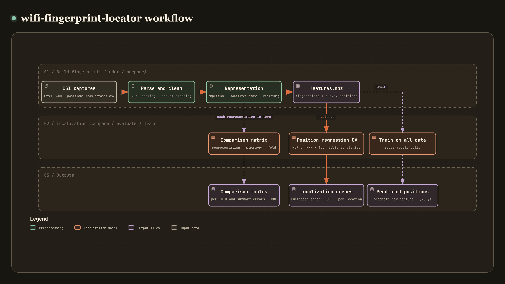

# wifi-fingerprint-locator

[](https://github.com/recklight/wifi-fingerprint-locator/actions/workflows/ci.yml)
[](https://www.python.org/downloads/)
[](LICENSE)

English | [繁體中文](README.zh-TW.md)

Indoor localization from WiFi channel state information (CSI) fingerprints. I compare amplitude, sanitized-phase and real/imaginary fingerprints side by side and regress the position with a neural network.

The package `wifi_fingerprint_locator` (command-line tool `wifi-fingerprint-locator`) reads beamforming-report captures recorded by an Intel 5300 NIC with the Linux 802.11n CSI Tool. Each packet is rescaled to $\sqrt{\mathrm{SNR}}$ units, cleaned and phase-sanitized, then turned into one of several fingerprint representations, from which a multilayer perceptron (MLP) or a fingerprint-matching baseline estimates the $(x, y)$ position. I evaluate with k-fold cross-validation under four split strategies (random packets, location blocks, held-out locations and time blocks) and report Euclidean localization errors, CDFs and per-location error plots.

Author: RL

---

## Contents

- [Overview](#overview)
- [Method](#method)
- [Installation](#installation)
- [Quick start](#quick-start)
- [Usage examples](#usage-examples)
- [CLI reference](#cli-reference)
- [Project structure](#project-structure)
- [Data preparation](#data-preparation)
- [Configuration files](#configuration-files)
- [Results and metrics](#results-and-metrics)
- [Known limitations](#known-limitations)
- [Design notes](#design-notes)
- [Development and testing](#development-and-testing)
- [References](#references)
- [License](#license)

---

## Overview

[](https://raw.githack.com/recklight/wifi-fingerprint-locator/master/docs/workflow.html?theme=dark)

Interactive workflow diagram: [view it online](https://raw.githack.com/recklight/wifi-fingerprint-locator/master/docs/workflow.html?theme=dark), or open [`docs/workflow.html`](docs/workflow.html) in a browser. You can zoom, search for nodes and trace the path between any two steps.

The idea of CSI fingerprinting is simple (Yang, Zhou & Liu, 2013): record the channel response at a set of known positions (reference points), train a model that maps a fingerprint to a position, then locate a new measurement from its channel. The details are the hard part. The phase reported by a commodity NIC carries a random offset that changes from packet to packet, the amplitude scale moves with the automatic gain control and the number of transmit streams, and occasionally an entry is quantized to 0. The biggest trap is the evaluation. A location gives one packet per second and neighboring packets are nearly identical, so if packets are shuffled into training and test sets, the error only shows how well the model recognizes places it has already seen, not whether it can locate a place it has not.

So the split strategy is a configuration key, like the representation, the model and every threshold. `compare` reads a survey once and runs every representation under every split strategy, and every run writes out its full configuration and a manifest, so results from different representations and different splits can sit in one table.

| Stage | What it does | Module |
| --- | --- | --- |
| Capture parsing | Decodes the bit-packed CSI of beamforming reports, restores the antenna order, counts damaged records | `beamform_report` |
| Power scaling | Rescales to $\sqrt{\mathrm{SNR}}$ units from RSSI, AGC and noise floor | `csi_scaling` |
| Survey assembly | Packet window, transmit stream and receive antenna selection, cleaning of the whole survey at once | `site_survey`, `channel_cleaning` |
| Phase sanitization | Removes a linear phase across subcarriers (endpoint slope or least squares) | `phase_sanitization`, `subcarriers` |
| Fingerprints | Amplitude, dB amplitude, sanitized phase, amplitude plus phase, real and imaginary parts, sanitized real and imaginary parts | `fingerprints` |
| Splits | Random packets, location blocks, held-out locations, time blocks; k-fold and single splits | `splits` |
| Models | MLP position regression (L-BFGS, Adam, Levenberg-Marquardt) and kNN-type baselines | `position_regressor`, `levenberg_marquardt`, `baselines`, `models` |
| Evaluation | Euclidean error, percentiles, grid accuracy, CDF; at packet and capture level | `metrics`, `evaluation` |
| Comparison matrix | Representation × split strategy × fold | `comparison` |
| Outputs | Figures, CSV files with the same numbers, configuration and manifest | `figures`, `manifest` |

---

## Method

### 1. Beamforming-report captures

A capture is a sequence of records, each `[uint16 big-endian length][uint8 code][payload]`; only code `0xBB` is CSI, everything else is skipped. The first 20 bytes of the payload are a little-endian header (time stamp, counter, $N_{rx}$, $N_{tx}$, the RSSI of the three antennas, noise floor, AGC, antenna selection, CSI length, rate flags), followed by the bit-packed CSI: for each subcarrier group the packer skips 3 bits, then writes $N_{rx}N_{tx}$ pairs of 8-bit signed integers (real, imaginary), with the transmit chain varying fastest. Because of the 3-bit skips most values straddle two bytes; the value starting at bit $b$ is

$$
v = \bigl(p[\lfloor b/8 \rfloor] \gg (b \bmod 8)\bigr) \;\big|\; \bigl(p[\lfloor b/8 \rfloor + 1] \ll (8 - b \bmod 8)\bigr).
$$

The decoder computes the bit offsets of all values at once and decodes a whole block with array operations; a test compares it with a bit-by-bit reference decoder. The CSI length field must equal $\lceil 30(16N_{rx}N_{tx}+3)/8 \rceil$. Records with a wrong length or cut off by the end of the file are counted and skipped (with `survey.strict: true` they raise an error); records with other codes are a normal part of a capture, so they are skipped and only counted in `n_other_codes`. The antenna selection field gives the physical antenna of every reported column; I apply it only when it is a valid permutation (Halperin et al., 2011).

| Key | Default | Effect |
| --- | --- | --- |
| `survey.apply_permutation` | `true` | Restore the receive columns to physical antenna order |
| `survey.strict` | `false` | Raise an error at the first damaged record instead of skipping it |

### 2. Rescaling to $\sqrt{\mathrm{SNR}}$ units

The NIC normalizes every packet with its automatic gain control, so the raw 8-bit values carry no absolute power. From the header, the total received power is

$$
P_{rx} = 10\log_{10}\sum_{c:\,\mathrm{rssi}_c \neq 0} 10^{\mathrm{rssi}_c/10} - 44 - \mathrm{AGC}\quad[\mathrm{dBm}],
$$

and with $s = 10^{P_{rx}/10} / (\sum|H|^2/30)$ and the noise floor $N$ (dBm; when the NIC reports $-127$, meaning unknown, a default value is used),

$$
\tilde H = H\sqrt{\frac{s}{10^{N/10} + s\,N_{rx}N_{tx}}},
$$

where the second term is the 8-bit quantization noise. Packets with two transmit streams are further multiplied by $\sqrt{2}$, three streams by $\sqrt{10^{0.45}}$ (Halperin et al., 2011). When all RSSI fields are 0, $\log_{10} 0$ is undefined; the result is NaN, which the cleaning stage removes, so no infinities appear.

| Key | Default | Effect |
| --- | --- | --- |
| `scaling.to_snr_units` | `true` | When off, the raw 8-bit values are used as they are |
| `scaling.noise_floor_fallback_dbm` | `-92.0` | Noise floor used when the reported one is unknown |
| `scaling.three_stream_gain_db` | `4.5` | Power compensation of three-stream packets |
| `scaling.compensate_stream_power` | `true` | Whether to apply the per-stream power compensation |

### 3. Survey assembly and cleaning

From each capture I take a packet window (`survey.n_packets` packets from `survey.packet_start` on; when a capture has fewer, a warning is logged and the available packets are used), one transmit stream and the chosen receive antennas, then clean all captures together, since the stream-count policy below looks at the whole survey:

- Non-finite values: packets whose rescaling failed are dropped (or, with `cleaning.drop_nonfinite: false`, raise an error).
- Mixed transmit-stream counts: the NIC switches between 1 and 2 streams from packet to packet, and the per-stream power compensation puts the two on different amplitude scales. `drop_minority` keeps only the stream count that is most common in the whole survey, `require_constant` raises an error on a mixture, and `keep` keeps everything.
- Zero entries: an entry quantized to $0+0j$ has no phase and corrupts the phase unwrap. `interpolate` interpolates its real and imaginary parts linearly from the other subcarriers of the same antenna, by subcarrier position (nearest value at the edges); `drop` drops the whole packet; `keep` leaves it alone.

`prepare` counts every drop and repair and writes the counts to its manifest.

| Key | Default | Effect |
| --- | --- | --- |
| `survey.n_packets` | `200` | Packets used from each capture; `null` uses all |
| `survey.tx_index`, `survey.rx_indices` | `0`, `null` | Transmit stream and receive antenna selection |
| `cleaning.n_tx_policy` | `drop_minority` | `keep`, `require_constant`, `drop_minority` |
| `cleaning.zero_entry_policy` | `interpolate` | `interpolate`, `drop`, `keep` |

### 4. Linear phase sanitization

The sampling-time offset of each packet adds a linear phase slope across subcarriers, and the carrier-frequency and PLL offsets add a constant; both change randomly from packet to packet. A straight line is fitted to the subcarrier positions $m_k$ and the unwrapped phases $\phi_k$ and removed (Sen et al., 2012):

$$
\hat\phi_k = \phi_k - a\,m_k - b .
$$

- `endpoint`: $a = (\phi_K - \phi_1)/(m_K - m_1)$ and $b = \bar\phi - a\,\bar m$, the transform of PhaseFi (Wang, Gao & Mao, 2015); the result has zero mean and equal end values.
- `lstsq`: a least-squares line through all subcarriers (Kotaru et al., 2015), less sensitive to noise on the edge subcarriers.

Both turn a purely linear phase into exactly 0, so adding any $a\,m + b$ to the input leaves the output unchanged. By default the subcarrier positions are the actual grouped indices of IEEE 802.11n at 20 MHz with $N_g = 2$, $-28, -26, \dots, -2, -1, 1, 3, \dots, 27, 28$ ($N_g = 4$ at 40 MHz); `uniform` instead places 30 equally spaced points between the two ends. That is a common approximation; I made it an option so the two layouts can be compared, and `examples/sanitize_channel_phase.py` does exactly that.

| Key | Default | Effect |
| --- | --- | --- |
| `features.phase_fit` | `endpoint` | `endpoint` or `lstsq` |
| `features.subcarrier_layout` | `grouped` | `grouped` (actual indices) or `uniform` (equally spaced approximation) |

### 5. Fingerprint representations

A cleaned measurement is the complex $H_{r,k}$ of one transmit stream on $N_{rx}$ antennas and 30 subcarriers, flattened antenna by antenna: the 30 subcarriers of the first antenna, then those of the second, and so on.

| Name | Length (3 antennas) | Content |
| --- | --- | --- |
| `amplitude` | 90 | $\lvert H\rvert$ (Wang et al., 2015; 2017) |
| `amplitude_db` | 90 | $20\log_{10}\max(\lvert H\rvert, \epsilon)$ |
| `sanitized_phase` | 90 | Sanitized phase $\hat\phi$ (PhaseFi) |
| `amplitude_phase` | 180 | Amplitude followed by sanitized phase. Using both quantities is close to the idea of BiLoc (Wang, Gao & Mao, 2017), but BiLoc uses the average amplitudes of adjacent antenna pairs and angles of arrival estimated from their sanitized phase differences |
| `real_imag` | 180 | $\Re H$ followed by $\Im H$, raw phase kept |
| `sanitized_real_imag` | 180 | Real and imaginary parts of $\lvert H\rvert e^{j\hat\phi}$, as an ablation |

`real_imag` keeps the random per-packet phase offsets, so I expect it to be the weakest representation; `sanitized_real_imag` differs from it only by the phase sanitization, so the gap between the two is what the sanitization contributes. Amplitudes ($\sqrt{\mathrm{SNR}}$ units) and phases (radians) have different scales, but the models scale every feature to $[-1, 1]$ separately, so no block-wise scaling is needed.

| Key | Default | Effect |
| --- | --- | --- |
| `features.representation` | `amplitude` | One of the six above |
| `features.amplitude_floor_db` | `-20.0` | Lower bound of `amplitude_db`, avoids $\log 0$ |

### 6. Split strategies

| Strategy | How it splits | What it measures |
| --- | --- | --- |
| `packet_random` | Packets shuffled and divided into k folds | Recognizing locations already seen in training; neighboring packets land in both training and test sets, so the result is optimistic |
| `location_block` | Reference points divided into k contiguous blocks in recording order | Extrapolation to a whole region that was never surveyed |
| `location_holdout` | Reference points shuffled and divided into k folds (a shuffled group k-fold) | Interpolation to locations that were never surveyed; training and test sets share no location |
| `temporal` | The packets of each reference point cut into k blocks in time; fold k tests the k-th block of every location | Stability while the channel drifts over time |

`packet_random` and `location_holdout` take their shuffling from `seed`, and the other two strategies involve no randomness, so results are reproducible. `holdout_indices` also gives a single training / validation / test split; for example, a location-block split of 56 reference points with 200 packets each and fractions $(5/7, 1/7, 1/7)$ gives exactly the indices 0–7999, 8000–9599 and 9600–11199.

| Key | Default | Effect |
| --- | --- | --- |
| `evaluation.split_strategy` | `location_holdout` | Strategy used by `evaluate` |
| `evaluation.n_splits` | `5` | Number of folds |

### 7. MLP position regression

`PositionRegressor` is a fully connected network of tanh hidden layers and a linear output layer, trained on the squared error plus an L2 penalty on the weights; the penalty $\alpha$ is on the same scale as `alpha` of scikit-learn's `MLPRegressor`. Inputs and outputs are scaled to $[-1, 1]$ on the training fold, and constant features are removed first. Three solvers:

- `lbfgs`: the L-BFGS quasi-Newton method (Liu & Nocedal, 1989), run through `MLPRegressor` from scikit-learn (Pedregosa et al., 2011). This is the default.
- `adam`: Adam stochastic gradient descent (Kingma & Ba, 2015).
- `levenberg_marquardt`: my own implementation of the damped Gauss-Newton method (Levenberg, 1944; Marquardt, 1963; Hagan & Menhaj, 1994), solving at every epoch

$$
(J^\top J + \alpha K D + \mu I)\,\Delta w = -(J^\top e + \alpha K D w),
$$

where $D$ selects the weights (not the biases) and $K$ is the number of outputs (2 here). scikit-learn's loss averages over the outputs; with the penalty multiplied by $K$, one `model.alpha` penalizes equally under all three solvers (a test compares the objective with the loss of `MLPRegressor`). A successful step sets $\mu \leftarrow \mu \cdot \mu_{dec}$, a failed one $\mu \leftarrow \mu \cdot \mu_{inc}$ and retries, and training stops once $\mu$ exceeds its upper bound. The Jacobian is computed exactly by back-propagation, one output at a time (a test checks it against finite differences), and the initial weights follow Nguyen-Widrow (Nguyen & Widrow, 1990). The method keeps the Jacobian and the $P \times P$ normal matrix in memory: the default 90-60-30-15-2 network has 7787 parameters and needs about 3 GB to train on 11200 packets, so `model.lm_memory_limit_mb` sets an upper limit, above which training stops with an error that suggests a smaller network or `lbfgs`.

All three solvers stop early on a validation set held out from the training fold (Prechelt, 1998): the validation error is checked every `epochs_per_check` iterations (every epoch for LM), training stops after `patience` checks without improvement, and the weights with the lowest validation error are restored. Which items go into the validation set depends on the split strategy. `location_holdout` and `location_block` test locations that were never surveyed, so the validation set is made of whole reference points held out from the training fold, about `model.validation_fraction` of them (at least 1, with at least 2 left for fitting). When the training fold has too few reference points for that, it falls back to random packets and logs a warning. Early stopping then picks the weights that do best on unseen locations; validating on other packets of the same reference points would pick the weights that best recognize places already seen. `packet_random`, `temporal` and `train` hold out random packets, so every reference point stays in the fitting data.

Adam runs epoch by epoch through `partial_fit`, so the validation checks reset neither the moment estimates nor the bias correction, and training is a single uninterrupted Adam run. When `model.alpha_grid` lists several penalties, one network is trained per value and the one with the lowest validation error is kept, a simplified substitute for Bayesian regularization (MacKay, 1992; Foresee & Hagan, 1997). Picking a value needs a validation set, so setting `model.patience` or `model.validation_fraction` to 0 is an error. All representations share the same `model` settings, which keeps the comparison fair.

| Key | Default | Effect |
| --- | --- | --- |
| `model.hidden_layer_sizes` | `[60, 30, 15]` | Width of each hidden layer |
| `model.solver` | `lbfgs` | `lbfgs`, `adam`, `levenberg_marquardt` |
| `model.alpha`, `model.alpha_grid` | `0.0001`, `[]` | L2 penalty; when the candidate list is not empty, the penalty is chosen by validation error |
| `model.max_epochs`, `model.epochs_per_check`, `model.patience` | `1000`, `10`, `6` | Iteration limit, check interval, patience |
| `model.validation_fraction` | `0.15` | Share held out for early stopping; under the location splits, a share of the reference points |
| `model.lm_initial_mu`, `lm_mu_decrease`, `lm_mu_increase`, `lm_mu_max` | `0.001`, `0.1`, `10`, `1e10` | LM damping schedule |

### 8. Fingerprint-matching baselines

A learned regressor is only worth it if it does better than classic fingerprint matching (Bahl & Padmanabhan, 2000), so I compare it with three matching baselines:

- `knn`, `weighted_knn`: find the $k$ nearest packets in signal space and average their positions (uniformly, or weighted by inverse distance).
- `nearest_reference`: every reference point is represented by its mean fingerprint, and a measurement is assigned to the reference point whose mean is nearest. It can only answer with a surveyed position, so in effect it classifies reference points.

The baselines share the MLP's front end (constant features removed, scaling to $[-1, 1]$) and are selected with `model.name`.

| Key | Default | Effect |
| --- | --- | --- |
| `model.name` | `mlp` | `mlp`, `knn`, `weighted_knn`, `nearest_reference` |
| `model.n_neighbors` | `5` | Neighbors used by `knn` and `weighted_knn` |

### 9. Metrics

Errors are always **Euclidean distances** $e_i = \lVert \hat p_i - p_i \rVert_2$ in meters, computed on test data only. Every fold reports `mae`, `rmse` (both axes pooled), `r2`, `pearson_r`, `spearman_rho` (computed per axis and averaged over the two axes), the mean, median and root mean square of the Euclidean error, its 67th / 80th / 90th / 95th percentiles and maximum, the MAE of each axis, and, after snapping every estimate to the nearest reference point, the grid accuracy and UAR (the unweighted average of the per-reference-point recalls, the same definition as `sklearn.metrics.balanced_accuracy_score`). The CDF is the share of errors at or below each threshold, with thresholds `evaluation.cdf_step_m` apart. The same metrics are also computed per capture, by averaging the estimates over all packets in the capture; that is what someone standing still for a while would get.

| Key | Default | Effect |
| --- | --- | --- |
| `evaluation.cdf_step_m` | `0.2` | Spacing of the CDF thresholds, in meters |
| `evaluation.compare_representations` | Four representations | Representations compared by `compare` |
| `evaluation.compare_strategies` | Four strategies | Split strategies compared by `compare` |

### 10. Synthetic data

The project ships no measured data. The tests, the examples and the `synthesize` command generate a survey with a small physical model and write it in the same format as real data. A transmitter with two antennas stands in a rectangular room, and a receiver with a linear antenna array is placed at each reference point of a regular grid. The channel is a sum of paths

$$
H_{t,r,k} = \sum_p g_{t,r,p}(1+\varepsilon_p)\,e^{-j2\pi f_k L_{t,r,p}/c},\qquad g = \rho_p\frac{\lambda}{4\pi L},
$$

made of the direct path, the four first-order wall reflections found with the image method (Allen & Berkley, 1979), and paths via fixed scatterers; the scatterer paths fluctuate from packet to packet (people walking around), and every packet also gets a gain jitter and additive noise. The reported packets deliberately carry the defects that a fingerprinting pipeline has to handle: a random sampling-time offset (a phase slope across subcarriers), a random common phase, a fixed phase offset per receive antenna, 8-bit quantization with an arbitrary packet scale, RSSI / AGC / noise-floor fields consistent with the true received power, occasional two-stream packets and zero entries, and shuffled receive columns. The received power falls with distance from the transmitter and the multipath pattern changes with position, so position can be learned, but being close does not by itself make two reference points look alike.

| Key | Default | Effect |
| --- | --- | --- |
| `synthetic.grid_shape`, `synthetic.grid_spacing_m` | `[8, 7]`, `1.0` | Reference-point grid |
| `synthetic.n_packets` | `200` | Packets per point and campaign |
| `synthetic.snr_db` | `30.0` | Signal-to-noise ratio of the channel measurement |
| `synthetic.max_timing_offset_ns` | `50.0` | Range of the sampling-time offset |
| `synthetic.two_stream_fraction`, `synthetic.zero_entry_rate` | `0.04`, `0.001` | Share of two-stream packets and of zero entries |

---

## Installation

Requires Python 3.10 or later.

```bash
git clone https://github.com/recklight/wifi-fingerprint-locator.git
cd wifi-fingerprint-locator
python -m venv .venv
# Windows: .venv\Scripts\activate    Linux/macOS: source .venv/bin/activate
pip install -e .                 # core
pip install -e ".[dev]"          # development tools: pytest, ruff
```

The only dependencies are NumPy, SciPy, scikit-learn, pandas, matplotlib, PyYAML, typer and joblib. Apart from `[dev]` there are no extras, so `pip install -e .` covers every command and example. The package also runs without being installed: from the project folder, `PYTHONPATH=src python -m wifi_fingerprint_locator --help`.

---

## Quick start

No data needed; the commands below start by generating a synthetic dataset.

```bash
# 1. Generate a synthetic dataset
wifi-fingerprint-locator synthesize --config configs/quick_demo.yaml --out data/synthetic
# 2. Prepare model inputs from the dataset index
wifi-fingerprint-locator prepare --config configs/quick_demo.yaml --out outputs/demo/prepare
# 3. Cross-validate
wifi-fingerprint-locator evaluate outputs/demo/prepare/features.npz --config configs/quick_demo.yaml --out outputs/demo/evaluate
# 4. Train on all the data
wifi-fingerprint-locator train outputs/demo/prepare/features.npz --config configs/quick_demo.yaml --out outputs/demo/train
# 5. Predict for a new input file
wifi-fingerprint-locator predict data/synthetic/items/item_000.dat --model outputs/demo/train/model.joblib --out outputs/demo/predict
```

Or run the whole workflow at once: `python examples/end_to_end_synthetic.py`.

> Scores on synthetic data only show that the software works; they say nothing about performance on real data.

---

## Usage examples

### CLI

For real data, start by putting the shared settings into a YAML file (for example `my_survey.yaml`), so that `prepare`, `evaluate` and `train` use the same feature settings:

```yaml
data:
  dataset: data/survey/dataset.csv
  grid_spacing_m: 0.6
features:
  representation: amplitude_phase
  phase_fit: lstsq
```

```bash
# 1. Build the dataset index from the file names (e.g. walk3-5.dat: x index 3, y index 5)
wifi-fingerprint-locator index data/survey --config my_survey.yaml
# 2. Inspect captures: packet counts, two-stream share, zero entries, timing
wifi-fingerprint-locator inspect data/survey/walk1-1.dat data/survey/walk1-2.dat --out outputs/survey/inspect
# 3. Build the fingerprints
wifi-fingerprint-locator prepare --config my_survey.yaml --out outputs/survey/prepare
# 4. Held-out-location cross-validation with another seed
wifi-fingerprint-locator evaluate outputs/survey/prepare/features.npz --config my_survey.yaml --seed 1 --out outputs/survey/evaluate
# 5. Same fingerprints, random-packet split and the kNN baseline, to see the gap
wifi-fingerprint-locator evaluate outputs/survey/prepare/features.npz --config my_survey.yaml --set evaluation.split_strategy=packet_random --set model.name=weighted_knn --out outputs/survey/evaluate_knn
# 6. Full representation × split-strategy comparison
wifi-fingerprint-locator compare --config my_survey.yaml --out outputs/survey/compare
# 7. Train, then locate a new capture
wifi-fingerprint-locator train outputs/survey/prepare/features.npz --config my_survey.yaml --out outputs/survey/train
wifi-fingerprint-locator predict data/new/walk_test.dat --model outputs/survey/train/model.joblib --out outputs/survey/predict
```

### Python API

```python
from wifi_fingerprint_locator import (
    Config,
    cross_validate,
    load_model,
    predict_inputs,
    prepare_features,
    read_beamform_file,
    sanitize_channel_phase,
    save_model,
    scale_csi,
    subcarrier_positions,
    train_model,
    write_synthetic_dataset,
)

config = Config.from_yaml("configs/quick_demo.yaml")

# 1. Generate a synthetic survey (same on-disk format as real data)
index = write_synthetic_dataset("data/synthetic", config.synthetic, rng=config.seed)

# 2. Low-level functions: read a capture, rescale to sqrt(SNR) units, sanitize the phase
reports, statistics = read_beamform_file("data/synthetic/items/item_000.dat")
channel = scale_csi(reports[0])[0]  # first transmit stream
phase = sanitize_channel_phase(channel, subcarrier_positions("grouped"))
print(statistics.n_reports, channel.shape, phase.shape)  # 20 (3, 30) (3, 30)

# 3. High-level workflow: whole survey -> fingerprints -> held-out-location cross-validation
features = prepare_features(index, config)
result = cross_validate(features, config)
print(round(result.metrics["pooled"]["mean_error_m"], 3))  # 2.142

# 4. Same fingerprints with a random-packet split: a much smaller error, but only for visited places
leaky = cross_validate(features, config.override({"evaluation.split_strategy": "packet_random"}))
print(round(leaky.metrics["pooled"]["mean_error_m"], 3))  # 0.172

# 5. Train, save, and predict with only the settings stored in the model file
model_path = save_model("outputs/model.joblib", train_model(features, config), config)
table = predict_inputs(["data/synthetic/items/item_005.dat"], load_model(model_path))
print(table[["predicted_x_m", "predicted_y_m"]].mean().round(2).tolist())  # [1.02, 1.99]; truth is (1, 2)
```

### Example scripts

Every script accepts `--out`, `--seed` and `--quick`; without `--quick` it uses `configs/synthetic_survey.yaml` (8 × 7 grid, 40 packets per point).

| Script | What it shows | Run time |
| --- | --- | --- |
| `examples/end_to_end_synthetic.py` | Synthesis, fingerprints, held-out-location cross-validation, training, prediction | About 3 s (`--quick` about 2 s) |
| `examples/sanitize_channel_phase.py` | The phase before and after sanitization, and the packet-to-packet stability of the two line estimators × the two subcarrier layouts | About 2 s |
| `examples/compare_feature_representations.py` | Errors and CDFs of five representations under the same split and the same model | About 20 s (`--quick` about 3 s) |
| `examples/compare_split_strategies.py` | Errors of amplitude fingerprints under the four split strategies, MLP next to weighted kNN | About 11 s (`--quick` about 3 s) |

---

## CLI reference

| Command | Purpose | Main input | Main output |
| --- | --- | --- | --- |
| `synthesize` | Generate a synthetic survey | Configuration file | Captures, `dataset.csv` |
| `index FOLDER` | Build the dataset index from grid indices in the file names | Folder of captures | `FOLDER/dataset.csv` |
| `inspect FILES...` | Quality summary of captures | Captures | `captures.csv` |
| `prepare` | Read, rescale, clean and build fingerprints | `data.dataset` | `features.npz`, `items.csv` |
| `evaluate FEATURES` | k-fold cross-validation under `evaluation.split_strategy` | `features.npz` | `metrics.json`, `folds.csv`, `predictions.csv`, `recording_predictions.csv`, figures and CSV files of the same name |
| `train FEATURES` | Train on all fingerprints | `features.npz` | `model.joblib` |
| `predict INPUTS... --model` | Estimate the position of every packet of new captures | Captures, `model.joblib` | `predictions.csv` |
| `compare` | Representation × split strategy × fold matrix | `data.dataset` | `comparison_folds.csv`, `comparison_summary.csv`, `comparison.json`, `error_cdf.*` |

| Option | Commands | Description |
| --- | --- | --- |
| `--log-level` | All (before the subcommand) | `DEBUG`, `INFO`, `WARNING` or `ERROR`, default `INFO`; the log goes to stderr |
| `--version` | All (before the subcommand) | Print the version and exit |
| `--config/-c PATH` | All but `predict` | YAML configuration file |
| `--set/-s KEY=VALUE` | All but `predict` | Override one setting, e.g. `--set model.alpha=0.001`; repeatable |
| `--seed INT` | `synthesize`, `evaluate`, `train`, `compare` | Master seed, same as `--set seed=INT` |
| `--dataset/-d PATH` | `prepare`, `compare` | Dataset index, same as `--set data.dataset=PATH` |
| `--out/-o PATH` | All but `index` | Output folder; without it, a `<command>_<UTC time>` folder is created under `output.root`, except for `synthesize`, which writes to `data/synthetic` by default. `index` always writes `FOLDER/dataset.csv` |
| `--model/-m PATH` | `predict` | Model file written by `train` |
| `--figures/--no-figures` | `evaluate`, `compare` | Whether to draw the figures as well (the CSV files are always written) |

Exit codes: 0 means success; 2 means a problem with the input or the configuration, reported as a single `error: ...` line (add `--log-level DEBUG` to see the full traceback); 1 means an interruption or a bug in the program.

---

## Project structure

```text
wifi-fingerprint-locator/
├── .github/
│   ├── ISSUE_TEMPLATE/
│   │   ├── bug_report.yml             # bug report form
│   │   ├── config.yml                 # disables blank issues
│   │   └── feature_request.yml        # feature request form
│   └── workflows/
│       └── ci.yml                     # lint, 3.10 syntax gate, tests on several platforms, oldest dependencies
├── configs/
│   ├── default.yaml                   # identical to Config(), every key commented
│   ├── levenberg_marquardt.yaml       # a small network trained with Levenberg-Marquardt
│   ├── quick_demo.yaml                # synthetic-data settings that finish in seconds
│   └── synthetic_survey.yaml          # medium synthetic survey for the example scripts
├── data/
│   └── .gitkeep                       # default place for your data
├── outputs/
│   └── .gitkeep                       # default root of the run folders
├── docs/
│   ├── images/workflow.png            # figure in README.md
│   ├── images/workflow.zh-TW.png      # figure in README.zh-TW.md
│   ├── workflow.html                  # interactive workflow diagram in English (open in a browser)
│   └── workflow.zh-TW.html            # the same diagram in Traditional Chinese
├── examples/
│   ├── end_to_end_synthetic.py        # end-to-end workflow
│   ├── sanitize_channel_phase.py      # phase before and after sanitization
│   ├── compare_feature_representations.py  # comparison of representations
│   └── compare_split_strategies.py    # comparison of split strategies
├── src/
│   └── wifi_fingerprint_locator/
│       ├── __init__.py                # public API
│       ├── __main__.py                # python -m entry point
│       ├── py.typed                   # type marker
│       ├── baselines.py               # nearest-reference-point baseline
│       ├── beamform_report.py         # capture reading and writing, bit decoding, antenna order
│       ├── channel_cleaning.py        # cleaning policies for stream counts, zero entries and non-finite values
│       ├── cli.py                     # typer command line
│       ├── comparison.py              # representation × split-strategy matrix
│       ├── config.py                  # configuration dataclasses, YAML reading and writing
│       ├── csi_scaling.py             # rescaling to sqrt(SNR) units
│       ├── dataset.py                 # dataset.csv and features.npz
│       ├── errors.py                  # exception classes
│       ├── evaluation.py              # k-fold cross-validation
│       ├── figures.py                 # figures and the tables behind them
│       ├── fingerprints.py            # registry of fingerprint representations
│       ├── levenberg_marquardt.py     # NumPy tanh MLP and LM training
│       ├── logging_utils.py           # logging setup
│       ├── manifest.py                # run folders and manifest
│       ├── metrics.py                 # Euclidean error, CDF, grid accuracy
│       ├── models.py                  # model registry and model files
│       ├── phase_sanitization.py      # phase unwrapping and linear sanitization
│       ├── pipeline.py                # prepare / train / predict / compare high-level API
│       ├── position_regressor.py      # MLP position regression with early stopping
│       ├── site_survey.py             # survey assembly and file-name index
│       ├── splits.py                  # the four split strategies
│       ├── subcarriers.py             # 802.11n subcarrier group indices
│       └── synthetic.py               # synthetic survey data
├── tests/                             # one test_<module>.py per module except errors.py, plus example, 3.10 compatibility and documentation checks
├── .gitattributes
├── .gitignore
├── CHANGELOG.md                       # in Traditional Chinese
├── CITATION.cff
├── CONTRIBUTING.md                    # in Traditional Chinese
├── LICENSE
├── README.md                          # English documentation (this file)
├── README.zh-TW.md                    # Traditional Chinese documentation
└── pyproject.toml
```

---

## Data preparation

**No data is included.** Put your own captures, recorded by an Intel 5300 with the Linux 802.11n CSI Tool, in any folder (`data/` is a good place; its contents stay out of version control), and write a dataset index.

### 1. Dataset index (dataset.csv)

| Column | Required | Description |
| --- | --- | --- |
| `path` | Yes | Path of the capture, relative to the folder of `dataset.csv` |
| `x_m` | Yes | x coordinate of the reference point, in meters |
| `y_m` | Yes | y coordinate of the reference point, in meters |
| `group` | No | Name of the reference point; when omitted, one is made from the coordinates (e.g. `x1.2_y0.6`). Repeated measurements at one location must share the name, so that the location splits keep them together |
| `campaign` | No | Measurement session, kept for bookkeeping only |

```csv
path,x_m,y_m,group,campaign
first/walk1-1.dat,0.0,0.0,A1,first
first/walk1-2.dat,0.0,0.6,A2,first
second/walk1-1.dat,0.0,0.0,A1,second
```

File names carry no meaning; positions and groups come from the columns only. When files listed in the index are missing, the program lists the first 5 missing files and the total, then stops.

### 2. File format

- Captures: binary records of the Linux 802.11n CSI Tool (see Method, section 1), one file per reference point; 20 MHz (30 subcarrier groups, $N_g = 2$) or 40 MHz both work, but one survey must not mix bandwidths, or an error is raised.
- Packets: by default the first 200 beamforming reports of each file are used (`survey.packet_start`, `survey.n_packets`); when a file has fewer, a warning is logged and the available packets are used.
- Antennas: all three receive antennas are used; `survey.rx_indices` selects a subset. When packets have a single transmit stream, `survey.tx_index` must be 0.
- Damaged records: truncated records and records with a wrong length are skipped and logged, or raise an error with `survey.strict: true`. Records with other codes are a normal part of a capture; they are skipped and counted in `n_other_codes`, not treated as damage.

### 3. Index from file names

When the captures are named after grid indices (for example `walk3-5.dat` for x index 3, y index 5), `wifi-fingerprint-locator index FOLDER` finds all files matching `data.file_pattern` (a regular expression with the named groups `x` and `y`, and optionally `campaign`), converts the indices to meters as $(\text{index} - \text{grid\_origin}) \times \text{grid\_spacing\_m}$, and writes `FOLDER/dataset.csv`. Set `data.grid_spacing_m` to the actual spacing of your survey.

---

## Configuration files

`configs/default.yaml` is identical to `Config()` and comments every key in English, so it is the complete list of settings. `configs/quick_demo.yaml` lists only the keys that differ from the defaults (4 × 3 grid, 20 packets per point, a small network, 3 folds), so the synthetic data runs in seconds; the quick start and the results below use it. `configs/synthetic_survey.yaml` is the medium-sized survey the example scripts use. `configs/levenberg_marquardt.yaml` trains a small network with one hidden layer of 10 units by Levenberg-Marquardt and raises the memory limit to 1024 MB: trained on the full-size survey, the 90-value representations need about 290 MB and the 180-value ones about 590 MB, more than the default 512 MB. The program never loads a configuration file on its own; without `--config`, the defaults apply.

| Section | Main keys | Description |
| --- | --- | --- |
| `seed` | — | Master seed: splits, model initialization and synthetic data all derive from it |
| `data` | `dataset`, `file_pattern`, `grid_spacing_m` | Where the dataset index is, and the file-name pattern `index` matches |
| `synthetic` | `grid_shape`, `n_packets`, `snr_db` | Size and channel parameters of the synthetic survey |
| `survey` | `packet_start`, `n_packets`, `tx_index`, `rx_indices` | Packet window, stream and antenna selection |
| `scaling` | `to_snr_units`, `noise_floor_fallback_dbm` | $\sqrt{\mathrm{SNR}}$ rescaling |
| `cleaning` | `n_tx_policy`, `zero_entry_policy` | Cleaning policies |
| `features` | `representation`, `phase_fit`, `subcarrier_layout` | Fingerprint representation and phase sanitization |
| `model` | `name`, `hidden_layer_sizes`, `solver`, `patience` | Model and training |
| `evaluation` | `split_strategy`, `n_splits`, `compare_representations`, `compare_strategies` | Cross-validation and the comparison matrix |
| `output` | `root`, `figure_format`, `dpi` | Output location and figure format |

The `survey`, `scaling`, `cleaning` and `features` sections decide what `prepare` writes. `evaluate` and `train` check that these four sections match the configuration stored in `features.npz`, and ask you to run `prepare` again when they do not. Unknown keys are an error that lists the valid keys, for example:

```text
$ wifi-fingerprint-locator evaluate outputs/demo/prepare/features.npz --set model.depth=3
error: unknown configuration key 'model.depth'; valid keys here are ['alpha', 'alpha_grid', 'epochs_per_check', 'hidden_layer_sizes', 'learning_rate', 'lm_initial_mu', 'lm_memory_limit_mb', 'lm_mu_decrease', 'lm_mu_increase', 'lm_mu_max', 'max_epochs', 'min_gradient', 'n_neighbors', 'name', 'patience', 'solver', 'validation_fraction']
```

---

## Results and metrics

Contents of an `evaluate` run folder:

```text
outputs/demo/evaluate/
├── config.yaml                 # full configuration actually used
├── manifest.json               # command, time, versions, SHA-256 of the inputs, seed
├── metrics.json                # per fold, mean ± std and pooled metrics (packet and capture level)
├── folds.csv                   # one row of metrics per fold
├── predictions.csv             # out-of-fold estimate of every packet
├── recording_predictions.csv   # estimates averaged per capture
├── residuals.csv / .png        # error vectors (dx, dy)
├── error_cdf.csv / .png        # error CDFs of packets and captures
└── location_errors.csv / .png  # mean error and mean error vector of every reference point
```

| File | Content |
| --- | --- |
| `metrics.json` | `task`, `n_items`, `n_splits`, `seed`, `folds`, `summary` (`mean` and `std` of every metric, `std` with `ddof=1`), `pooled`, `recordings` |
| `folds.csv` | `fold`, `n_train`, `n_test` and all scalar metrics |
| `predictions.csv` | `path`, `segment` (index of the packet within its file), `group`, `fold`, `x_m`, `y_m`, `predicted_x_m`, `predicted_y_m`, `error_m`, in the order of `items.csv` |
| `recording_predictions.csv` | One row per capture; `fold` is -1 when the packets of a capture were tested in several folds (random-packet and time-block splits) |
| `residuals.*`, `error_cdf.*`, `location_errors.*` | Figures and the numbers behind them |

| Metric | Definition | Why it matters |
| --- | --- | --- |
| `mean_error_m`, `median_error_m` | Mean and median of the Euclidean error | The numbers the localization literature reports most; the median is not swayed by a few large errors |
| `p67_error_m` … `p95_error_m`, `max_error_m` | Percentiles and maximum of the Euclidean error | Describe the tail of the error distribution, points on the CDF |
| `rmse_error_m` | Root mean square of the Euclidean error | Penalizes large errors more |
| `mae`, `rmse`, `r2`, `pearson_r`, `spearman_rho` | General regression metrics: `mae` and `rmse` pool both axes; `r2`, `pearson_r` and `spearman_rho` are computed per axis and averaged | For comparison with other regression problems; a negative `r2` means worse than always predicting the mean position |
| `mae_x_m`, `mae_y_m` | Mean absolute error of each axis | Shows whether the error is concentrated in one direction |
| `grid_accuracy`, `grid_uar` | Hit rate after snapping estimates to the nearest reference point, and the unweighted average of the per-reference-point recalls | Treats localization as a many-class classification of reference points; with no positive class, I do not report sensitivity, specificity or ROC-AUC |

### Quick-start results (`configs/quick_demo.yaml`)

These numbers come from the quick-start commands below (4 × 3 grid, 20 packets per point, 231 packets after cleaning, 3-fold held-out-location cross-validation, MLP 16-8), run on Python 3.10 with NumPy 2.2.6, SciPy 1.15.3 and scikit-learn 1.7.2; with other versions of these packages the MLP numbers may differ in the third decimal.

```bash
wifi-fingerprint-locator synthesize --config configs/quick_demo.yaml --out data/synthetic
wifi-fingerprint-locator prepare --config configs/quick_demo.yaml --out outputs/demo/prepare
wifi-fingerprint-locator evaluate outputs/demo/prepare/features.npz --config configs/quick_demo.yaml --out outputs/demo/evaluate
```

| Metric | Packet level (mean ± std) | Capture level (mean ± std) |
| --- | --- | --- |
| `mean_error_m` | 2.142 ± 0.021 | 2.124 ± 0.014 |
| `median_error_m` | 2.374 ± 0.199 | 2.361 ± 0.100 |
| `p90_error_m` | 2.897 ± 0.265 | 2.754 ± 0.210 |
| `mae` | 1.366 ± 0.042 | — |
| `r2` | -2.033 ± 0.813 | — |
| `grid_accuracy` | 0.078 ± 0.135 | 0.083 ± 0.144 |

On a 3 m × 2 m grid, held-out-location validation gives a mean error above 2 m, a grid accuracy close to random guessing (1/12) and a negative `r2`: the model cannot locate reference points it never saw during training. Under a random-packet split the same model gets 0.172 m (next section), so the gap comes from the evaluation, not from a broken model.

### Representation × split strategy (`configs/quick_demo.yaml`)

```bash
wifi-fingerprint-locator compare --config configs/quick_demo.yaml --out outputs/demo/compare
```

Mean Euclidean error (meters, mean ± std, 3 folds):

| Representation | `packet_random` | `temporal` | `location_block` | `location_holdout` |
| --- | --- | --- | --- | --- |
| `amplitude` | 0.172 ± 0.044 | 0.162 ± 0.019 | 1.726 ± 0.384 | 2.142 ± 0.021 |
| `sanitized_phase` | 1.007 ± 0.015 | 1.042 ± 0.033 | 1.742 ± 0.420 | 1.636 ± 0.179 |
| `amplitude_phase` | 0.340 ± 0.078 | 0.332 ± 0.005 | 1.868 ± 0.297 | 2.006 ± 0.068 |
| `real_imag` | 1.327 ± 0.009 | 1.356 ± 0.026 | 1.875 ± 0.225 | 1.801 ± 0.125 |

Grid accuracy (mean ± std):

| Representation | `packet_random` | `temporal` | `location_block` | `location_holdout` |
| --- | --- | --- | --- | --- |
| `amplitude` | 0.983 ± 0.020 | 0.982 ± 0.016 | 0.013 ± 0.022 | 0.078 ± 0.135 |
| `sanitized_phase` | 0.312 ± 0.079 | 0.339 ± 0.062 | 0.030 ± 0.041 | 0.035 ± 0.033 |
| `amplitude_phase` | 0.853 ± 0.072 | 0.840 ± 0.017 | 0.017 ± 0.030 | 0.009 ± 0.015 |
| `real_imag` | 0.134 ± 0.007 | 0.157 ± 0.036 | 0.034 ± 0.059 | 0.056 ± 0.040 |

### Full-size synthetic survey (`configs/default.yaml`)

8 × 7 grid, 200 packets per point (10756 packets after cleaning), MLP 60-30-15, 5 folds; about 15 minutes on a computer with a 20-thread CPU:

```bash
wifi-fingerprint-locator synthesize --out data/synthetic_full
wifi-fingerprint-locator compare --dataset data/synthetic_full/dataset.csv --out outputs/compare_full
```

Mean Euclidean error (meters, mean ± std, 5 folds):

| Representation | `packet_random` | `temporal` | `location_block` | `location_holdout` |
| --- | --- | --- | --- | --- |
| `amplitude` | 0.260 ± 0.014 | 0.242 ± 0.009 | 3.347 ± 0.893 | 2.980 ± 0.526 |
| `sanitized_phase` | 0.552 ± 0.037 | 0.547 ± 0.013 | 3.533 ± 0.784 | 2.985 ± 0.187 |
| `amplitude_phase` | 0.223 ± 0.009 | 0.231 ± 0.004 | 3.412 ± 0.702 | 3.028 ± 0.260 |
| `real_imag` | 1.034 ± 0.026 | 1.020 ± 0.043 | 3.215 ± 1.005 | 2.897 ± 0.322 |

Grid accuracy (mean ± std):

| Representation | `packet_random` | `temporal` | `location_block` | `location_holdout` |
| --- | --- | --- | --- | --- |
| `amplitude` | 0.935 ± 0.011 | 0.948 ± 0.009 | 0.016 ± 0.034 | 0.022 ± 0.035 |
| `sanitized_phase` | 0.658 ± 0.031 | 0.664 ± 0.010 | 0.018 ± 0.040 | 0.001 ± 0.001 |
| `amplitude_phase` | 0.962 ± 0.006 | 0.957 ± 0.006 | 0.035 ± 0.032 | 0.019 ± 0.025 |
| `real_imag` | 0.282 ± 0.016 | 0.277 ± 0.020 | 0.019 ± 0.037 | 0.020 ± 0.016 |

### Medium survey used by the example scripts (`configs/synthetic_survey.yaml`)

8 × 7 grid, 40 packets per point, MLP 30-15, 5 folds; the numbers come from the `summary.csv` that the example scripts write when run without `--quick`:

```bash
python examples/compare_split_strategies.py
python examples/compare_feature_representations.py
```

Mean Euclidean error of amplitude fingerprints under the four split strategies (meters, mean ± std):

| Model | `packet_random` | `temporal` | `location_block` | `location_holdout` |
| --- | --- | --- | --- | --- |
| `mlp` | 0.521 ± 0.029 | 0.553 ± 0.014 | 3.312 ± 0.756 | 3.160 ± 0.310 |
| `weighted_knn` | 0.060 ± 0.017 | 0.058 ± 0.015 | 3.492 ± 0.689 | 3.128 ± 0.425 |

Mean Euclidean error of five representations under the `temporal` split (meters, mean ± std):

| `amplitude` | `sanitized_phase` | `amplitude_phase` | `real_imag` | `sanitized_real_imag` |
| --- | --- | --- | --- | --- |
| 0.553 ± 0.014 | 1.107 ± 0.027 | 0.454 ± 0.027 | 2.195 ± 0.027 | 0.465 ± 0.020 |

### Reading the results

The split decides the conclusion. As long as the test locations also appear in the training set (`packet_random`, `temporal`), amplitude-type fingerprints match more than nine out of ten packets to the right reference point at full size; once whole reference points are held out (`location_block`, `location_holdout`), every representation jumps to an error of about 3 m and a grid accuracy close to random guessing (1/56). Report only the random-packet split, and recognizing places already seen passes for localization.

Under the location splits, early stopping watches unsurveyed reference points. On the full survey the lowest validation error came within the first 60 iterations in 39 of the 40 folds (in one `amplitude_phase` fold the minimum came only at iteration 370); after that, the network keeps fitting the training locations while the validation error stops going down, which is also why a fold of these two columns usually takes only about 2 s.

At known locations the ranking of the representations is clear: those with amplitude (`amplitude`, `amplitude_phase`, `sanitized_real_imag`) do best, `sanitized_phase` alone comes next, and `real_imag` with the raw phase does worst. Which of `amplitude` and `amplitude_phase` comes first depends on the size of the survey: amplitude wins with the quick settings, amplitude plus phase with the medium and full sizes. `real_imag` and `sanitized_real_imag` differ only by the phase sanitization, and the error drops from 2.195 m to 0.465 m; that gap is what the random per-packet phase offsets cost.

The MLP numbers only mean something next to the baselines. At known locations in the medium survey, weighted kNN has a far lower mean error (0.060 m) than the MLP (0.521 m), and under held-out locations both fail. Only when a regressor beats fingerprint matching on held-out locations can I say it has learned how the channel relates to position.

---

## Known limitations

- The synthetic channel has only first-order wall reflections and a few point scatterers, much simpler than a real room, so every number in this README only shows that the software works. On a real survey, run `compare` again and go by the held-out-location results.
- Only load model files from sources you trust. `model.joblib` is stored with joblib (pickle) and can run arbitrary code when it is loaded.
- No GPU is needed, but the full comparison matrix takes a while. All models train on the CPU with scikit-learn or NumPy; with the default settings (56 reference points × 200 packets, MLP 60-30-15, L-BFGS) a fold of the random-packet and time-block splits takes about 20 s, while a fold of the location splits usually takes about 2 s because early stopping ends them sooner; the 4 representations × 4 strategies × 5 folds of `compare` take about 15 minutes and less than 1 GB of memory. The memory of the Levenberg-Marquardt solver grows with the square of the number of parameters: the default network on the full survey needs about 3 GB, and above `model.lm_memory_limit_mb` training stops with an error.
- Only one transmit stream is used. By default the first stream is taken, and the second stream of two-stream packets goes unused; `survey.tx_index: 1` switches to the second stream, but then only the two-stream packets are left.
- The cleaning in `predict` covers only its input files: `drop_minority` keeps the stream count most common among the inputs, not the one most common in the training data. With only a few input files, train again with `cleaning.n_tx_policy: keep`, or make sure the inputs have the same stream count as the training data.
- The regressor can output positions between reference points, but under held-out locations the current fingerprints cannot interpolate reliably to unsurveyed places; locating positions off the reference points needs a denser survey or a model that builds in spatial continuity.
- Under the location splits, the early-stopping validation set consists of whole reference points held out from the training fold, so the network is never fitted to them (with the quick settings, only 7 of the 8 training reference points of a fold are fitted), and the stopping point rests on those few locations, which makes it noisy. A larger `model.validation_fraction` steadies the decision but leaves fewer reference points for fitting.

---

## Design notes

### Evaluation

- The error of an estimate is its Euclidean distance from the true position, which counts the offsets in x and y together, and it is computed on out-of-fold test estimates only. The MAE of each axis is reported as well, to show whether the error leans toward one direction.
- The four split strategies sit in one comparison matrix. Packets about 1 second apart at the same location are nearly identical, and a random-packet split puts them in both the training and the test set; with the four side by side, that optimism is the gap you see within one row of the table.
- Which items form the early-stopping validation set depends on the split strategy (see Method, section 7). Under the location splits it is made of whole reference points, so early stopping also looks at unsurveyed reference points, and model selection asks the same question as the evaluation.
- Every run folder has `config.yaml` and `manifest.json` with the split strategy, the seed and the full configuration, so every number can be traced to the split it actually used.
- Every result comes from k-fold cross-validation and is reported as mean ± std (`ddof=1`). Rerunning with the same seed in the same environment gives byte-identical CSV and JSON files, except for the time stamp in `manifest.json`.
- All representations share the same model settings, the same folds and the same seed, and the comparison matrix reads the survey once, so two cells of the table differ only in representation or split strategy.
- Three baselines (kNN, weighted kNN and nearest reference point) are there to show whether the learned regressor beats plain fingerprint matching.
- Coordinates in the dataset index are in meters (`index` converts grid indices with `data.grid_spacing_m`), so every error, CDF threshold and figure axis is in meters. `evaluate` draws the capture-level CDF in the same figure as the packet-level one and also writes a per-location error plot.

### Signal processing and data

- The capture parser is plain vectorized NumPy, so it needs no compiled module; a test compares it with a bit-by-bit reference decoder. Truncated records, wrong lengths and invalid antenna permutations are all counted; `survey.strict` turns the truncated and wrong-length ones into errors, and reports whose antenna selection is not a permutation are kept in reported order.
- Non-finite packets, changing transmit-stream counts and zero entries each have a cleaning policy, and every packet dropped or entry repaired is counted. All-zero RSSI fields give NaN, which cleaning drops, so no infinity reaches the fingerprints; zero entries are interpolated only within one antenna.
- Subcarrier layout (grouped 802.11n indices by default, equally spaced as an option), line estimator (end points or least squares), representation, split strategy, paths, grid size, packet window and thresholds are all configuration keys, so trying another combination needs no code change.

### Models

- All three solvers stop early on a validation set and restore the best weights; for Adam, the validation checks do not reset the optimizer state.
- Levenberg-Marquardt uses the exact Jacobian. Before training it estimates the memory of the Jacobian and the normal matrix, and above `model.lm_memory_limit_mb` it stops with an error right away instead of running out of memory halfway.
- `model.alpha` has the same scale under all three solvers; `model.alpha_grid` picks a value from the candidate list by validation error, and `train` writes the chosen value to its manifest.
- Model files store the full configuration, and `predict` rebuilds the fingerprints from those settings only, exactly as in training.

### Engineering

The full comparison is 4 representations × 4 split strategies × 5 folds, and every one of those numbers has to trace back to its settings. So every setting lives in a frozen dataclass that is read and written as YAML, a mistyped key is an error rather than a silent default, and paths come only from the configuration or the command-line options. The typer command line turns an expected error into a single `error: ...` line and exit code 2. Progress and warnings go through logging to stderr, so stdout carries only the short summary a command prints when it finishes. Every figure has a CSV of the same numbers next to it, so redrawing it or reusing the numbers needs no rerun.

---

## Development and testing

```bash
pip install -e ".[dev]"
python -m pytest -q                 # all tests, doctests included
python -m ruff check .
python -m ruff format --check .
# Python 3.10 syntax gate (runs on any Python version)
python -c "import ast,pathlib; [ast.parse(p.read_text(encoding='utf-8'), str(p), feature_version=(3, 10)) for p in pathlib.Path('.').rglob('*.py') if not {'.venv', 'build', 'dist', '__pycache__'} & set(p.parts)]"
```

Numerical functions are checked against closed-form results or reference implementations: the bit decoder against a bit-by-bit version, the power rescaling against hand-computed values, the phase sanitization against `numpy.polyfit`, the Jacobian against finite differences, the LM penalty scale against the loss of `MLPRegressor`, and the metrics against scikit-learn and SciPy. Besides the tests for each module, two test files check the project as a whole:

- `tests/test_python310_compat.py` parses every file with Python 3.10 syntax and scans for standard-library names that only exist from 3.11 on, names that are incompatible between NumPy 1.x and 2.x, and APIs newer than the declared minimum dependency versions. It also checks that `import wifi_fingerprint_locator` and the command line do not load `matplotlib.pyplot` (all figures use the object-oriented API, so no display is needed).
- `tests/test_documentation.py` checks the wording of the docs (Traditional characters and Taiwan usage in the Chinese text) and the section order of both READMEs, and catches local paths or e-mail addresses written into a file by accident.

The tests also run the four example scripts once each with `--quick`. CI runs Python 3.10–3.13 on Linux and Windows, plus one job on the oldest dependency versions (all of these minimums install on Python 3.10).

---

## References

### Channel state information and fingerprinting

- D. Halperin, W. Hu, A. Sheth, and D. Wetherall, "Tool release: Gathering 802.11n traces with channel state information," *ACM SIGCOMM Computer Communication Review*, vol. 41, no. 1, p. 53, 2011.
- P. Bahl and V. N. Padmanabhan, "RADAR: An in-building RF-based user location and tracking system," in *Proc. IEEE INFOCOM*, 2000, pp. 775–784.
- Z. Yang, Z. Zhou, and Y. Liu, "From RSSI to CSI: Indoor localization via channel response," *ACM Computing Surveys*, vol. 46, no. 2, article 25, 2013.
- X. Wang, L. Gao, S. Mao, and S. Pandey, "DeepFi: Deep learning for indoor fingerprinting using channel state information," in *Proc. IEEE Wireless Communications and Networking Conference (WCNC)*, 2015, pp. 1666–1671.
- X. Wang, L. Gao, S. Mao, and S. Pandey, "CSI-based fingerprinting for indoor localization: A deep learning approach," *IEEE Transactions on Vehicular Technology*, vol. 66, no. 1, pp. 763–776, 2017.
- X. Wang, L. Gao, and S. Mao, "PhaseFi: Phase fingerprinting for indoor localization with a deep learning approach," in *Proc. IEEE Global Communications Conference (GLOBECOM)*, 2015.
- X. Wang, L. Gao, and S. Mao, "BiLoc: Bi-modal deep learning for indoor localization with commodity 5GHz WiFi," *IEEE Access*, vol. 5, pp. 4209–4220, 2017.

### Phase sanitization

- S. Sen, B. Radunovic, R. R. Choudhury, and T. Minka, "You are facing the Mona Lisa: Spot localization using PHY layer information," in *Proc. ACM International Conference on Mobile Systems, Applications, and Services (MobiSys)*, 2012, pp. 183–196.
- M. Kotaru, K. Joshi, D. Bharadia, and S. Katti, "SpotFi: Decimeter level localization using WiFi," in *Proc. ACM SIGCOMM*, 2015, pp. 269–282.

### Neural network training

- K. Levenberg, "A method for the solution of certain non-linear problems in least squares," *Quarterly of Applied Mathematics*, vol. 2, no. 2, pp. 164–168, 1944.
- D. W. Marquardt, "An algorithm for least-squares estimation of nonlinear parameters," *Journal of the Society for Industrial and Applied Mathematics*, vol. 11, no. 2, pp. 431–441, 1963.
- M. T. Hagan and M. B. Menhaj, "Training feedforward networks with the Marquardt algorithm," *IEEE Transactions on Neural Networks*, vol. 5, no. 6, pp. 989–993, 1994.
- D. Nguyen and B. Widrow, "Improving the learning speed of 2-layer neural networks by choosing initial values of the adaptive weights," in *Proc. International Joint Conference on Neural Networks (IJCNN)*, vol. 3, 1990, pp. 21–26.
- D. C. Liu and J. Nocedal, "On the limited memory BFGS method for large scale optimization," *Mathematical Programming*, vol. 45, pp. 503–528, 1989.
- D. P. Kingma and J. Ba, "Adam: A method for stochastic optimization," in *Proc. International Conference on Learning Representations (ICLR)*, 2015.
- L. Prechelt, "Early stopping — but when?," in *Neural Networks: Tricks of the Trade*, G. B. Orr and K.-R. Müller, Eds., Lecture Notes in Computer Science, vol. 1524. Berlin, Germany: Springer, 1998, pp. 55–69.
- D. J. C. MacKay, "Bayesian interpolation," *Neural Computation*, vol. 4, no. 3, pp. 415–447, 1992.
- F. D. Foresee and M. T. Hagan, "Gauss-Newton approximation to Bayesian learning," in *Proc. International Conference on Neural Networks (ICNN)*, 1997, pp. 1930–1935.

### Standards, simulation and software

- IEEE Std 802.11n-2009, "IEEE Standard for Information technology — Local and metropolitan area networks — Specific requirements — Part 11: Wireless LAN Medium Access Control (MAC) and Physical Layer (PHY) Specifications Amendment 5: Enhancements for Higher Throughput," 2009.
- J. B. Allen and D. A. Berkley, "Image method for efficiently simulating small-room acoustics," *The Journal of the Acoustical Society of America*, vol. 65, no. 4, pp. 943–950, 1979.
- F. Pedregosa et al., "Scikit-learn: Machine learning in Python," *Journal of Machine Learning Research*, vol. 12, pp. 2825–2830, 2011.

---

## License

MIT License, Copyright (c) 2026 RL. See [LICENSE](LICENSE).
