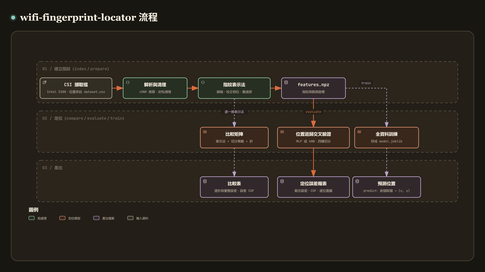

# wifi-fingerprint-locator

[](https://github.com/recklight/wifi-fingerprint-locator/actions/workflows/ci.yml)
[](https://www.python.org/downloads/)
[](LICENSE)

[English](README.md) | 繁體中文

以 WiFi 通道狀態資訊（Channel State Information, CSI）指紋做室內定位，比較振幅、校正後相位與實部加虛部三類指紋表示法，並以類神經網路迴歸出位置。

本專案（Python 套件 `wifi_fingerprint_locator`，命令列工具 `wifi-fingerprint-locator`）讀取 Intel 5300 網卡以 Linux 802.11n CSI Tool 錄下的 beamforming report 擷取檔，把每個封包換算成 $\sqrt{\mathrm{SNR}}$ 單位、清理並校正相位，轉成可切換的指紋表示法，再以多層感知器（MLP）或指紋比對基準模型估計 $(x, y)$ 位置；評估時以封包隨機、位置區塊、留位置與時間區塊四種切分策略做 k 折交叉驗證，輸出歐氏定位誤差、CDF 與逐位置誤差圖。

作者：RL

---

## 目錄

- [專案簡介](#專案簡介)
- [方法說明](#方法說明)
- [安裝步驟](#安裝步驟)
- [快速開始](#快速開始)
- [使用範例](#使用範例)
- [CLI 指令對照表](#cli-指令對照表)
- [專案結構](#專案結構)
- [資料準備](#資料準備)
- [設定檔](#設定檔)
- [結果與評估指標](#結果與評估指標)
- [已知限制](#已知限制)
- [設計重點](#設計重點)
- [開發與測試](#開發與測試)
- [References](#references)
- [License](#license)

---

## 專案簡介

[](https://raw.githack.com/recklight/wifi-fingerprint-locator/master/docs/workflow.zh-TW.html?theme=dark)

互動式流程圖：[線上瀏覽](https://raw.githack.com/recklight/wifi-fingerprint-locator/master/docs/workflow.zh-TW.html?theme=dark)，或在本機用瀏覽器開啟 [`docs/workflow.zh-TW.html`](docs/workflow.zh-TW.html)。可以縮放、搜尋節點，也能追蹤任兩個步驟之間的路徑。

CSI 指紋定位的想法很直接（Yang, Zhou & Liu, 2013）：在一組已知位置（參考點）上錄下通道響應，訓練一個從指紋對應到位置的模型，之後用新量到的通道反推位置。困難在細節：商用網卡回報的相位帶有每個封包都不同的隨機偏移，振幅的尺度會隨自動增益控制與傳送串流數改變，偶爾還有被量化成 0 的項目。影響最大的是評估方式：同一個位置每秒一個封包，相鄰封包幾乎一模一樣，若把封包隨機分到訓練與測試集，測得的誤差只代表「認得已經去過的位置」，不代表能定位到沒去過的地方。

所以切分策略和表示法、模型與所有門檻一樣，都是設定檔裡的一個鍵。`compare` 只讀一次勘測資料，讓每種表示法在每種切分策略下各跑一遍；每次執行也都寫出完整設定與 manifest，不同表示法、不同切分的結果才放得進同一張表比較。

| 階段 | 做什麼 | 對應模組 |
| --- | --- | --- |
| 擷取檔解析 | 解碼 beamforming report 的位元封裝 CSI、還原天線排列、統計損毀記錄 | `beamform_report` |
| 功率換算 | 依 RSSI、AGC 與雜訊底限換算成 $\sqrt{\mathrm{SNR}}$ 單位 | `csi_scaling` |
| 勘測組裝 | 封包視窗、傳送串流與接收天線選擇、整份勘測一起清理 | `site_survey`、`channel_cleaning` |
| 相位校正 | 沿子載波扣除線性相位（端點斜率或最小平方） | `phase_sanitization`、`subcarriers` |
| 指紋表示 | 振幅、dB 振幅、校正相位、振幅加相位、實虛部、校正後實虛部 | `fingerprints` |
| 切分 | 封包隨機、位置區塊、留位置、時間區塊；k 折與單次切分 | `splits` |
| 模型 | MLP 位置迴歸（L-BFGS、Adam、Levenberg-Marquardt）與 kNN 類基準 | `position_regressor`、`levenberg_marquardt`、`baselines`、`models` |
| 評估 | 歐氏誤差、百分位數、格點命中率、CDF；封包與擷取檔兩個層級 | `metrics`、`evaluation` |
| 比較矩陣 | 表示法 × 切分策略 × 折 | `comparison` |
| 輸出 | 圖表、同內容的 CSV、設定與 manifest | `figures`、`manifest` |

---

## 方法說明

### 1. Beamforming report 擷取檔

擷取檔是一連串記錄，每筆為 `[uint16 big-endian 長度][uint8 代碼][內容]`，只有代碼 `0xBB` 是 CSI，其餘略過。內容前 20 bytes 是 little-endian 標頭（時間戳記、計數器、$N_{rx}$、$N_{tx}$、三根天線的 RSSI、雜訊底限、AGC、天線選擇、CSI 長度、速率旗標），之後是位元封裝的 CSI：每個子載波群組先跳過 3 bits，再接 $N_{rx}N_{tx}$ 組 8 位元有號整數（實部、虛部），傳送鏈變化最快。由於 3 bits 的位移，多數數值橫跨兩個 byte，第 $b$ 個位元起的數值為

$$
v = \bigl(p[\lfloor b/8 \rfloor] \gg (b \bmod 8)\bigr) \;\big|\; \bigl(p[\lfloor b/8 \rfloor + 1] \ll (8 - b \bmod 8)\bigr).
$$

解碼器一次算出所有數值的位元位置，以陣列運算完成整個區塊，並與逐位元的參考寫法比對過。CSI 長度欄位必須等於 $\lceil 30(16N_{rx}N_{tx}+3)/8 \rceil$，不符或截斷的記錄會被計數並略過（`survey.strict: true` 時直接報錯）；其他代碼的記錄是擷取檔裡的正常內容，直接略過，只計入 `n_other_codes`。天線選擇欄位給出每個回報欄位對應的實體天線，只有在它確實是一個排列時才套用（Halperin et al., 2011）。

| 設定鍵 | 預設 | 作用 |
| --- | --- | --- |
| `survey.apply_permutation` | `true` | 把接收欄位還原成實體天線順序 |
| `survey.strict` | `false` | 遇到第一筆損毀記錄就報錯，而不是略過 |

### 2. 換算成 $\sqrt{\mathrm{SNR}}$ 單位

網卡以自動增益控制正規化每個封包，原始 8 位元數值沒有絕對功率意義。依標頭換算總接收功率

$$
P_{rx} = 10\log_{10}\sum_{c:\,\mathrm{rssi}_c \neq 0} 10^{\mathrm{rssi}_c/10} - 44 - \mathrm{AGC}\quad[\mathrm{dBm}],
$$

令 $s = 10^{P_{rx}/10} / (\sum|H|^2/30)$，雜訊底限為 $N$（dBm，回報 $-127$ 表示未知，此時使用預設值），則

$$
\tilde H = H\sqrt{\frac{s}{10^{N/10} + s\,N_{rx}N_{tx}}},
$$

第二項是 8 位元量化雜訊。兩個傳送串流再乘 $\sqrt{2}$、三個乘 $\sqrt{10^{0.45}}$（Halperin et al., 2011）。RSSI 全為 0 時 $\log_{10} 0$ 沒有定義，這時回傳 NaN，交給清理階段剔除，不會產生無限大。

| 設定鍵 | 預設 | 作用 |
| --- | --- | --- |
| `scaling.to_snr_units` | `true` | 關掉時直接使用原始 8 位元數值 |
| `scaling.noise_floor_fallback_dbm` | `-92.0` | 雜訊底限未知時採用的值 |
| `scaling.three_stream_gain_db` | `4.5` | 三串流封包的功率補償 |
| `scaling.compensate_stream_power` | `true` | 是否套用每串流功率補償 |

### 3. 勘測組裝與資料清理

每個擷取檔取封包視窗（`survey.packet_start` 起 `survey.n_packets` 筆，不足時以警告告知並使用現有的封包），選一個傳送串流與指定的接收天線，所有擷取檔再**一起**清理：

- 非有限值：換算失敗的封包剔除（或設 `cleaning.drop_nonfinite: false` 直接報錯）。
- 傳送串流數混雜：網卡會在 1 與 2 個串流間逐封包切換，而每串流功率補償會讓兩者的振幅尺度不同。`drop_minority` 只保留整份勘測最常見的串流數，`require_constant` 遇到混雜就報錯，`keep` 全部保留。
- 0 值項目：量化成 $0+0j$ 的項目沒有相位、會污染相位展開。`interpolate` 以同一根天線其餘子載波的實部與虛部依子載波位置線性內插（邊界取最近值），`drop` 剔除整個封包，`keep` 不處理。

每一類剔除與修補都會計數，寫進 `prepare` 的 manifest。

| 設定鍵 | 預設 | 作用 |
| --- | --- | --- |
| `survey.n_packets` | `200` | 每個擷取檔使用的封包數，`null` 為全部 |
| `survey.tx_index`、`survey.rx_indices` | `0`、`null` | 傳送串流與接收天線選擇 |
| `cleaning.n_tx_policy` | `drop_minority` | `keep`、`require_constant`、`drop_minority` |
| `cleaning.zero_entry_policy` | `interpolate` | `interpolate`、`drop`、`keep` |

### 4. 相位線性校正

每個封包的取樣時間偏移在子載波間造成線性相位斜率，載波頻率與鎖相迴路偏移造成常數相位，兩者都逐封包隨機。以子載波位置 $m_k$ 與展開後的相位 $\phi_k$ 擬合一條直線並扣除（Sen et al., 2012）：

$$
\hat\phi_k = \phi_k - a\,m_k - b .
$$

- `endpoint`：$a = (\phi_K - \phi_1)/(m_K - m_1)$、$b = \bar\phi - a\,\bar m$，即 PhaseFi 的轉換（Wang, Gao & Mao, 2015）；結果平均為 0 且首尾相等。
- `lstsq`：以全部子載波做最小平方直線擬合（Kotaru et al., 2015），對邊緣子載波的雜訊較不敏感。

兩者對純線性相位都完全還原為 0，因此輸入加上任意 $a\,m + b$ 不改變輸出。子載波位置預設採用 IEEE 802.11n 在 20 MHz 下 $N_g = 2$ 的實際分組索引 $-28, -26, \dots, -2, -1, 1, 3, \dots, 27, 28$（40 MHz 為 $N_g = 4$）；`uniform` 則在首尾之間等距取 30 點，這是常見的近似；做成選項是為了能和實際索引比較，`examples/sanitize_channel_phase.py` 比的就是這兩種。

| 設定鍵 | 預設 | 作用 |
| --- | --- | --- |
| `features.phase_fit` | `endpoint` | `endpoint` 或 `lstsq` |
| `features.subcarrier_layout` | `grouped` | `grouped`（實際索引）或 `uniform`（等距近似） |

### 5. 指紋表示法

清理後的量測是一個傳送串流在 $N_{rx}$ 根天線、30 個子載波上的複數 $H_{r,k}$，攤平順序為「第一根天線的 30 個子載波，接著第二根……」。

| 名稱 | 長度（3 根天線） | 內容 |
| --- | --- | --- |
| `amplitude` | 90 | $\lvert H\rvert$（Wang et al., 2015；2017） |
| `amplitude_db` | 90 | $20\log_{10}\max(\lvert H\rvert, \epsilon)$ |
| `sanitized_phase` | 90 | 校正後相位 $\hat\phi$（PhaseFi） |
| `amplitude_phase` | 180 | 振幅接校正相位。兩種量並用的想法與 BiLoc 相近（Wang, Gao & Mao, 2017），但 BiLoc 用的是相鄰天線對的平均振幅，以及由校正後相位差估計的到達角 |
| `real_imag` | 180 | $\Re H$ 接 $\Im H$，保留原始相位 |
| `sanitized_real_imag` | 180 | $\lvert H\rvert e^{j\hat\phi}$ 的實部與虛部，用來做消融對照 |

`real_imag` 保留了逐封包的隨機相位偏移，預期是最弱的表示法；`sanitized_real_imag` 只差在先做相位校正，兩者的差距就是相位校正的貢獻。振幅（$\sqrt{\mathrm{SNR}}$ 單位）與相位（弧度）的尺度不同，模型對每個特徵各自縮放到 $[-1, 1]$，因此不需要另外做區塊縮放。

| 設定鍵 | 預設 | 作用 |
| --- | --- | --- |
| `features.representation` | `amplitude` | 上表六種之一 |
| `features.amplitude_floor_db` | `-20.0` | `amplitude_db` 的下限，避免 $\log 0$ |

### 6. 切分策略

| 策略 | 切法 | 量的是什麼 |
| --- | --- | --- |
| `packet_random` | 封包打散後分成 k 折 | 認得已去過的位置；相鄰封包同時在訓練與測試集，結果偏樂觀 |
| `location_block` | 參考點依錄製順序分成 k 個連續區塊 | 外插到一整片沒量過的區域 |
| `location_holdout` | 參考點打散後分成 k 折（打散的分組 k 折） | 內插到沒量過的位置；訓練與測試集沒有共同位置 |
| `temporal` | 每個參考點的封包依時間切成 k 段，第 k 折測每個位置的第 k 段 | 通道隨時間漂移時的穩定度 |

`packet_random` 與 `location_holdout` 的打散由 `seed` 決定，另外兩種策略沒有隨機成分，結果都可重現。`holdout_indices` 另外提供單次的訓練／驗證／測試切分，例如 56 個參考點、每點 200 封包、比例 $(5/7, 1/7, 1/7)$ 的位置區塊切分，正好得到索引 0–7999、8000–9599、9600–11199。

| 設定鍵 | 預設 | 作用 |
| --- | --- | --- |
| `evaluation.split_strategy` | `location_holdout` | `evaluate` 使用的策略 |
| `evaluation.n_splits` | `5` | 折數 |

### 7. 多層感知器位置迴歸

`PositionRegressor` 是 tanh 隱藏層加線性輸出層的全連接網路，以平方誤差加權重的 L2 懲罰訓練，懲罰係數 $\alpha$ 與 scikit-learn `MLPRegressor` 的 `alpha` 同尺度；輸入與輸出都在訓練折上縮放到 $[-1, 1]$，常數特徵先移除。三種求解器：

- `lbfgs`：L-BFGS 擬牛頓法（Liu & Nocedal, 1989），透過 scikit-learn（Pedregosa et al., 2011）的 `MLPRegressor`，預設。
- `adam`：Adam 隨機梯度法（Kingma & Ba, 2015）。
- `levenberg_marquardt`：自行實作的阻尼高斯-牛頓法（Levenberg, 1944；Marquardt, 1963；Hagan & Menhaj, 1994），每個 epoch 解

$$
(J^\top J + \alpha K D + \mu I)\,\Delta w = -(J^\top e + \alpha K D w),
$$

其中 $D$ 選出權重（不含偏置），$K$ 是輸出數（這裡是 2）。scikit-learn 的損失對輸出取平均，懲罰項乘上 $K$ 之後，同一個 `model.alpha` 在三種求解器的懲罰強度才相同（測試會和 `MLPRegressor` 的損失比對）。成功就 $\mu \leftarrow \mu \cdot \mu_{dec}$，失敗則 $\mu \leftarrow \mu \cdot \mu_{inc}$ 重試，$\mu$ 超過上限即停止。Jacobian 由逐輸出的反向傳播精確算出（測試以有限差分驗證），初始權重採 Nguyen-Widrow 法（Nguyen & Widrow, 1990）。這個方法需要把 Jacobian 與 $P \times P$ 的正規矩陣放進記憶體，預設的 90-60-30-15-2 網路有 7787 個參數，以 11200 個封包訓練約需 3 GB，因此設有 `model.lm_memory_limit_mb` 上限，超過時直接報錯，並建議換成小網路或 `lbfgs`。

三種求解器都以訓練折中保留的驗證集提早停止（Prechelt, 1998）：每 `epochs_per_check` 次迭代（LM 為每個 epoch）檢查一次驗證誤差，連續 `patience` 次沒有改善就停止，並還原驗證誤差最低時的權重。驗證集怎麼取，跟著評估方式走。`location_holdout` 與 `location_block` 測的是沒量過的位置，所以驗證集是從訓練折中整個留出約 `model.validation_fraction` 的參考點（至少 1 個，擬合部分至少留 2 個；訓練折的參考點太少、留不出來時，改從封包中隨機保留並記一筆警告），早停挑的是對沒量過的位置最好的權重；如果用的是同一批參考點的其他封包，挑出來的會是最會認已去過位置的權重。`packet_random`、`temporal` 與 `train` 則從封包中隨機保留，所有參考點都留在擬合資料裡。

Adam 以逐 epoch 的 `partial_fit` 執行，中途的驗證檢查不會重置動量估計與偏差校正，整段訓練是一次不中斷的 Adam。`model.alpha_grid` 列出多個懲罰係數時，每個各訓練一次網路，保留驗證誤差最低者，作為貝氏正則化（MacKay, 1992；Foresee & Hagan, 1997）的簡化替代；挑選要靠驗證集，所以 `model.patience` 或 `model.validation_fraction` 為 0 時會直接報錯。所有表示法共用同一個 `model` 設定，比較才公平。

| 設定鍵 | 預設 | 作用 |
| --- | --- | --- |
| `model.hidden_layer_sizes` | `[60, 30, 15]` | 各隱藏層寬度 |
| `model.solver` | `lbfgs` | `lbfgs`、`adam`、`levenberg_marquardt` |
| `model.alpha`、`model.alpha_grid` | `0.0001`、`[]` | L2 懲罰係數；候選清單非空時以驗證誤差挑選 |
| `model.max_epochs`、`model.epochs_per_check`、`model.patience` | `1000`、`10`、`6` | 迭代上限、檢查間隔、容忍次數 |
| `model.validation_fraction` | `0.15` | 早停用的驗證比例；位置類切分下是參考點的比例 |
| `model.lm_initial_mu`、`lm_mu_decrease`、`lm_mu_increase`、`lm_mu_max` | `0.001`、`0.1`、`10`、`1e10` | LM 阻尼排程 |

### 8. 指紋比對基準

學到的迴歸模型值不值得，要和傳統的指紋比對比較（Bahl & Padmanabhan, 2000）：

- `knn`、`weighted_knn`：在訊號空間找最近的 $k$ 個封包，平均（或以距離倒數加權）其位置。
- `nearest_reference`：每個參考點以平均指紋代表，量測指定給最近的平均指紋所屬的參考點；它只能回答量過的位置，本質上是參考點分類器。

基準模型與 MLP 共用同一個「移除常數特徵、縮放到 $[-1, 1]$」的前處理，以 `model.name` 切換。

| 設定鍵 | 預設 | 作用 |
| --- | --- | --- |
| `model.name` | `mlp` | `mlp`、`knn`、`weighted_knn`、`nearest_reference` |
| `model.n_neighbors` | `5` | `knn` 與 `weighted_knn` 的鄰居數 |

### 9. 評估指標

誤差一律是**歐氏距離** $e_i = \lVert \hat p_i - p_i \rVert_2$（公尺），只在測試資料上計算。每折報告 `mae`、`rmse`（兩軸合併計算）、`r2`、`pearson_r`、`spearman_rho`（兩軸各自計算後平均）、歐氏誤差的平均、中位數、均方根、第 67／80／90／95 百分位數與最大值、兩軸各自的 MAE，以及把估計值對齊到最近參考點後的格點命中率與 UAR（各參考點召回率的未加權平均，與 `sklearn.metrics.balanced_accuracy_score` 定義相同）。CDF 為誤差小於等於各門檻的比例，門檻間距為 `evaluation.cdf_step_m`。同樣的指標也在擷取檔層級計算：一個擷取檔所有封包的估計值取平均，代表使用者在原地停留一段時間所得的位置。

| 設定鍵 | 預設 | 作用 |
| --- | --- | --- |
| `evaluation.cdf_step_m` | `0.2` | CDF 門檻的間距（公尺） |
| `evaluation.compare_representations` | 四種表示法 | `compare` 指令比較的表示法 |
| `evaluation.compare_strategies` | 四種策略 | `compare` 指令比較的切分策略 |

### 10. 合成資料

專案不附任何量測資料，測試、範例與 `synthesize` 指令都用一個小型物理模型產生勘測資料，並以與真實資料相同的格式寫出。兩根天線的發射端位於矩形房間內，接收端的線性天線陣列放在規則網格的每個參考點，通道為多條路徑的和

$$
H_{t,r,k} = \sum_p g_{t,r,p}(1+\varepsilon_p)\,e^{-j2\pi f_k L_{t,r,p}/c},\qquad g = \rho_p\frac{\lambda}{4\pi L},
$$

包含直達路徑、以鏡像源法（Allen & Berkley, 1979）求得的四面牆一次反射，以及經過固定散射體的路徑；散射體路徑逐封包擾動（模擬走動的人），每個封包再加上增益抖動與加成性雜訊。回報的封包刻意帶有指紋管線必須處理的缺陷：隨機的取樣時間偏移（子載波間的相位斜率）、隨機的共同相位、每根接收天線固定的相位偏移、8 位元量化與任意的封包尺度、與真實接收功率一致的 RSSI／AGC／雜訊底限欄位、偶爾出現的雙串流封包與 0 值項目，以及被打亂的接收欄位順序。接收功率隨與發射端的距離衰減、多徑樣式隨位置改變，因此位置可以學，但相鄰參考點不會簡單地相似。

| 設定鍵 | 預設 | 作用 |
| --- | --- | --- |
| `synthetic.grid_shape`、`synthetic.grid_spacing_m` | `[8, 7]`、`1.0` | 參考點網格 |
| `synthetic.n_packets` | `200` | 每點每次量測的封包數 |
| `synthetic.snr_db` | `30.0` | 通道量測的訊雜比 |
| `synthetic.max_timing_offset_ns` | `50.0` | 取樣時間偏移的範圍 |
| `synthetic.two_stream_fraction`、`synthetic.zero_entry_rate` | `0.04`、`0.001` | 雙串流封包與 0 值項目的比例 |

---

## 安裝步驟

需要 Python 3.10 以上。

```bash
git clone https://github.com/recklight/wifi-fingerprint-locator.git
cd wifi-fingerprint-locator
python -m venv .venv
# Windows: .venv\Scripts\activate    Linux/macOS: source .venv/bin/activate
pip install -e .                 # 核心
pip install -e ".[dev]"          # 開發工具：pytest、ruff
```

相依套件只有 NumPy、SciPy、scikit-learn、pandas、matplotlib、PyYAML、typer 與 joblib。除了 `[dev]` 沒有其他選用套件組，`pip install -e .` 就能跑所有指令與範例。也可以不安裝，直接在專案資料夾內以 `PYTHONPATH=src python -m wifi_fingerprint_locator --help` 執行。

---

## 快速開始

不需要任何資料，以下指令會先產生合成資料集。

```bash
# 1. 產生合成資料集
wifi-fingerprint-locator synthesize --config configs/quick_demo.yaml --out data/synthetic
# 2. 由資料集索引準備模型輸入
wifi-fingerprint-locator prepare --config configs/quick_demo.yaml --out outputs/demo/prepare
# 3. 交叉驗證
wifi-fingerprint-locator evaluate outputs/demo/prepare/features.npz --config configs/quick_demo.yaml --out outputs/demo/evaluate
# 4. 以全部資料訓練
wifi-fingerprint-locator train outputs/demo/prepare/features.npz --config configs/quick_demo.yaml --out outputs/demo/train
# 5. 對新的輸入檔推論
wifi-fingerprint-locator predict data/synthetic/items/item_000.dat --model outputs/demo/train/model.joblib --out outputs/demo/predict
```

也可以一次跑完整個流程：`python examples/end_to_end_synthetic.py`。

> 合成資料上的分數只證明軟體能正確運作，不代表真實資料上的表現。

---

## 使用範例

### CLI

真實資料的工作流程。先把共用的設定寫成一份 YAML（例如 `my_survey.yaml`），讓 `prepare`、`evaluate`、`train` 用同一份特徵設定：

```yaml
data:
  dataset: data/survey/dataset.csv
  grid_spacing_m: 0.6
features:
  representation: amplitude_phase
  phase_fit: lstsq
```

```bash
# 1. 由檔名建立資料集索引（檔名如 walk3-5.dat：x 索引 3、y 索引 5）
wifi-fingerprint-locator index data/survey --config my_survey.yaml
# 2. 檢查擷取檔：封包數、雙串流比例、0 值項目、時間間隔
wifi-fingerprint-locator inspect data/survey/walk1-1.dat data/survey/walk1-2.dat --out outputs/survey/inspect
# 3. 建立指紋
wifi-fingerprint-locator prepare --config my_survey.yaml --out outputs/survey/prepare
# 4. 留位置交叉驗證，換一個種子
wifi-fingerprint-locator evaluate outputs/survey/prepare/features.npz --config my_survey.yaml --seed 1 --out outputs/survey/evaluate
# 5. 同一批指紋換成封包隨機切分與 kNN 基準，比較差距
wifi-fingerprint-locator evaluate outputs/survey/prepare/features.npz --config my_survey.yaml --set evaluation.split_strategy=packet_random --set model.name=weighted_knn --out outputs/survey/evaluate_knn
# 6. 表示法 × 切分策略的完整比較
wifi-fingerprint-locator compare --config my_survey.yaml --out outputs/survey/compare
# 7. 訓練並定位新的擷取檔
wifi-fingerprint-locator train outputs/survey/prepare/features.npz --config my_survey.yaml --out outputs/survey/train
wifi-fingerprint-locator predict data/new/walk_test.dat --model outputs/survey/train/model.joblib --out outputs/survey/predict
```

### Python API

```python
from wifi_fingerprint_locator import (
    Config,
    cross_validate,
    load_model,
    predict_inputs,
    prepare_features,
    read_beamform_file,
    sanitize_channel_phase,
    save_model,
    scale_csi,
    subcarrier_positions,
    train_model,
    write_synthetic_dataset,
)

config = Config.from_yaml("configs/quick_demo.yaml")

# 1. 產生合成勘測資料（與真實資料相同的磁碟格式）
index = write_synthetic_dataset("data/synthetic", config.synthetic, rng=config.seed)

# 2. 低階函式：讀一個擷取檔、換算成 sqrt(SNR) 單位、校正相位
reports, statistics = read_beamform_file("data/synthetic/items/item_000.dat")
channel = scale_csi(reports[0])[0]  # 第一個傳送串流
phase = sanitize_channel_phase(channel, subcarrier_positions("grouped"))
print(statistics.n_reports, channel.shape, phase.shape)  # 20 (3, 30) (3, 30)

# 3. 高階流程：整份勘測 -> 指紋 -> 留位置交叉驗證
features = prepare_features(index, config)
result = cross_validate(features, config)
print(round(result.metrics["pooled"]["mean_error_m"], 3))  # 2.142

# 4. 同一批指紋換成封包隨機切分：誤差小得多，但那是認得已去過的位置
leaky = cross_validate(features, config.override({"evaluation.split_strategy": "packet_random"}))
print(round(leaky.metrics["pooled"]["mean_error_m"], 3))  # 0.172

# 5. 訓練、存檔、只用模型檔裡的設定推論
model_path = save_model("outputs/model.joblib", train_model(features, config), config)
table = predict_inputs(["data/synthetic/items/item_005.dat"], load_model(model_path))
print(table[["predicted_x_m", "predicted_y_m"]].mean().round(2).tolist())  # [1.02, 1.99]，真值為 (1, 2)
```

### 範例腳本

每支腳本都接受 `--out`、`--seed` 與 `--quick`；不加 `--quick` 時使用 `configs/synthetic_survey.yaml`（8 × 7 網格、每點 40 封包）。

| 腳本 | 示範什麼 | 執行時間 |
| --- | --- | --- |
| `examples/end_to_end_synthetic.py` | 合成、建立指紋、留位置交叉驗證、訓練、推論 | 約 3 秒（`--quick` 約 2 秒） |
| `examples/sanitize_channel_phase.py` | 相位校正前後對照，以及兩種直線估計 × 兩種子載波位置的封包間穩定度 | 約 2 秒 |
| `examples/compare_feature_representations.py` | 五種表示法在同一切分、同一模型下的誤差與 CDF | 約 20 秒（`--quick` 約 3 秒） |
| `examples/compare_split_strategies.py` | 振幅指紋在四種切分策略下的誤差，MLP 與加權 kNN 並列 | 約 11 秒（`--quick` 約 3 秒） |

---

## CLI 指令對照表

| 指令 | 用途 | 主要輸入 | 主要輸出 |
| --- | --- | --- | --- |
| `synthesize` | 產生合成勘測資料 | 設定檔 | 擷取檔、`dataset.csv` |
| `index FOLDER` | 依檔名中的格點索引建立資料集索引 | 擷取檔資料夾 | `FOLDER/dataset.csv` |
| `inspect FILES...` | 擷取檔品質摘要 | 擷取檔 | `captures.csv` |
| `prepare` | 讀取、換算、清理並建立指紋 | `data.dataset` | `features.npz`、`items.csv` |
| `evaluate FEATURES` | 依 `evaluation.split_strategy` 做 k 折交叉驗證 | `features.npz` | `metrics.json`、`folds.csv`、`predictions.csv`、`recording_predictions.csv`、圖與同名 CSV |
| `train FEATURES` | 以全部指紋訓練 | `features.npz` | `model.joblib` |
| `predict INPUTS... --model` | 估計新擷取檔每個封包的位置 | 擷取檔、`model.joblib` | `predictions.csv` |
| `compare` | 表示法 × 切分策略 × 折的比較矩陣 | `data.dataset` | `comparison_folds.csv`、`comparison_summary.csv`、`comparison.json`、`error_cdf.*` |

| 選項 | 適用指令 | 說明 |
| --- | --- | --- |
| `--log-level` | 全部（寫在子指令之前） | `DEBUG`、`INFO`、`WARNING` 或 `ERROR`，預設 `INFO`；日誌輸出到 stderr |
| `--version` | 全部（寫在子指令之前） | 顯示版本後結束 |
| `--config/-c PATH` | `predict` 以外的指令 | YAML 設定檔 |
| `--set/-s KEY=VALUE` | `predict` 以外的指令 | 覆寫一個設定，例如 `--set model.alpha=0.001`，可重複 |
| `--seed INT` | `synthesize`、`evaluate`、`train`、`compare` | 主種子，等同 `--set seed=INT` |
| `--dataset/-d PATH` | `prepare`、`compare` | 資料集索引，等同 `--set data.dataset=PATH` |
| `--out/-o PATH` | `index` 以外的指令 | 輸出資料夾；省略時在 `output.root` 下建立 `<指令>_<UTC 時間>`，只有 `synthesize` 預設寫到 `data/synthetic`。`index` 固定寫出 `FOLDER/dataset.csv` |
| `--model/-m PATH` | `predict` | `train` 寫出的模型檔 |
| `--figures/--no-figures` | `evaluate`、`compare` | 是否同時畫出圖檔（CSV 一律寫出） |

exit code：0 表示成功；2 表示輸入或設定有誤，只印一行 `error: ...`（加上 `--log-level DEBUG` 可看到完整 traceback）；1 表示被中斷或程式本身的錯誤。

---

## 專案結構

```text
wifi-fingerprint-locator/
├── .github/
│   ├── ISSUE_TEMPLATE/
│   │   ├── bug_report.yml             # 錯誤回報表單
│   │   ├── config.yml                 # 關閉空白 issue
│   │   └── feature_request.yml        # 功能建議表單
│   └── workflows/
│       └── ci.yml                     # lint、3.10 語法閘門、多平台測試、最舊相依版本
├── configs/
│   ├── default.yaml                   # 與 Config() 完全相同，逐鍵附註解
│   ├── levenberg_marquardt.yaml       # 以 Levenberg-Marquardt 訓練小網路
│   ├── quick_demo.yaml                # 幾秒內跑完的合成資料設定
│   └── synthetic_survey.yaml          # 範例腳本用的中型合成勘測
├── data/
│   └── .gitkeep                       # 使用者資料的預設位置
├── outputs/
│   └── .gitkeep                       # 執行資料夾的預設根目錄
├── docs/
│   ├── images/workflow.png            # README.md 的流程圖
│   ├── images/workflow.zh-TW.png      # README.zh-TW.md 的流程圖
│   ├── workflow.html                  # 英文版互動式流程圖（瀏覽器開啟）
│   └── workflow.zh-TW.html            # 繁體中文版互動式流程圖
├── examples/
│   ├── end_to_end_synthetic.py        # 端到端流程
│   ├── sanitize_channel_phase.py      # 相位校正前後對照
│   ├── compare_feature_representations.py  # 表示法比較
│   └── compare_split_strategies.py    # 切分策略比較
├── src/
│   └── wifi_fingerprint_locator/
│       ├── __init__.py                # 公開 API
│       ├── __main__.py                # python -m 進入點
│       ├── py.typed                   # 型別標記
│       ├── baselines.py               # 最近參考點基準模型
│       ├── beamform_report.py         # 擷取檔讀寫、位元解碼、天線排列
│       ├── channel_cleaning.py        # 串流數、0 值項目與非有限值的清理政策
│       ├── cli.py                     # typer 命令列
│       ├── comparison.py              # 表示法 × 切分策略比較矩陣
│       ├── config.py                  # 設定 dataclass 與 YAML 讀寫
│       ├── csi_scaling.py             # 換算成 sqrt(SNR) 單位
│       ├── dataset.py                 # dataset.csv 與 features.npz
│       ├── errors.py                  # 例外類別
│       ├── evaluation.py              # k 折交叉驗證
│       ├── figures.py                 # 圖表與同內容的表格
│       ├── fingerprints.py            # 指紋表示法登錄表
│       ├── levenberg_marquardt.py     # NumPy 版 tanh MLP 與 LM 訓練
│       ├── logging_utils.py           # logging 設定
│       ├── manifest.py                # 執行資料夾與 manifest
│       ├── metrics.py                 # 歐氏誤差、CDF、格點命中率
│       ├── models.py                  # 模型登錄表與模型檔
│       ├── phase_sanitization.py      # 相位展開與線性校正
│       ├── pipeline.py                # prepare／train／predict／compare 高階 API
│       ├── position_regressor.py      # 帶早停的 MLP 位置迴歸
│       ├── site_survey.py             # 勘測組裝與檔名索引
│       ├── splits.py                  # 四種切分策略
│       ├── subcarriers.py             # 802.11n 子載波分組索引
│       └── synthetic.py               # 合成勘測資料
├── tests/                             # 除 errors.py 外每個模組一個 test_<module>.py，另有範例、3.10 相容性與文件檢查
├── .gitattributes
├── .gitignore
├── CHANGELOG.md
├── CITATION.cff
├── CONTRIBUTING.md
├── LICENSE
├── README.md                          # 英文說明
├── README.zh-TW.md                    # 繁體中文說明（本檔）
└── pyproject.toml
```

---

## 資料準備

**本專案不附任何資料。** 請自行準備 Intel 5300 以 Linux 802.11n CSI Tool 錄下的擷取檔，放在任意資料夾（建議 `data/` 底下，該資料夾的內容不會進版控），並建立一份資料集索引。

### 1. 資料集索引 dataset.csv

| 欄位 | 必要 | 說明 |
| --- | --- | --- |
| `path` | 是 | 擷取檔路徑，相對於 `dataset.csv` 所在的資料夾 |
| `x_m` | 是 | 參考點的 x 座標（公尺） |
| `y_m` | 是 | 參考點的 y 座標（公尺） |
| `group` | 否 | 參考點名稱；省略時由座標產生（例如 `x1.2_y0.6`）。同一位置的多次量測要用同一個名稱，留位置切分才會把它們放在一起 |
| `campaign` | 否 | 量測場次，只做紀錄 |

```csv
path,x_m,y_m,group,campaign
first/walk1-1.dat,0.0,0.0,A1,first
first/walk1-2.dat,0.0,0.6,A2,first
second/walk1-1.dat,0.0,0.0,A1,second
```

檔名不承載任何意義，位置與分組只從欄位讀取。索引中列的檔案不存在時，程式會列出前 5 個缺少的檔案與總數後停止。

### 2. 檔案格式

- 擷取檔：Linux 802.11n CSI Tool 的二進位記錄（見方法說明第 1 節），一個參考點一個檔案；20 MHz（30 個子載波群組、$N_g = 2$）或 40 MHz 皆可，但同一份勘測不可混用頻寬，否則會報錯。
- 封包數：預設每個檔案使用前 200 個 beamforming report（`survey.packet_start`、`survey.n_packets` 可改）；不足時以警告告知並使用現有的封包。
- 天線：三根接收天線全用；`survey.rx_indices` 可只取部分天線。只有單一傳送串流的封包時，`survey.tx_index` 應為 0。
- 損毀記錄：截斷與長度不符的記錄會被略過並記錄在日誌，`survey.strict: true` 時改為直接報錯。其他代碼的記錄是擷取檔裡的正常內容，直接略過並計入 `n_other_codes`，不算損毀。

### 3. 由檔名建立索引

若擷取檔以格點索引命名（例如 `walk3-5.dat` 表示 x 索引 3、y 索引 5），`wifi-fingerprint-locator index FOLDER` 會依 `data.file_pattern`（正規表示式，需要具名群組 `x` 與 `y`，可選 `campaign`）找出所有檔案，以 $(\text{索引} - \text{grid\_origin}) \times \text{grid\_spacing\_m}$ 換算成公尺，寫出 `FOLDER/dataset.csv`。格點間距請依實際量測設定 `data.grid_spacing_m`。

---

## 設定檔

`configs/default.yaml` 與 `Config()` 完全相同，逐鍵附英文註解，是所有可調參數的完整清單；`configs/quick_demo.yaml` 只列與預設不同的鍵（4 × 3 網格、每點 20 封包、小網路、3 折），讓合成資料在幾秒內跑完，「快速開始」與下方的結果都使用它；`configs/synthetic_survey.yaml` 是範例腳本用的中型設定；`configs/levenberg_marquardt.yaml` 以 Levenberg-Marquardt 訓練單一隱藏層 10 個神經元的小網路，並把記憶體上限提高到 1024 MB：以完整規模的勘測訓練時，90 值的表示法約需 290 MB，180 值的表示法約需 590 MB，超過預設的 512 MB。程式不會自動載入任何設定檔，沒給 `--config` 時就用預設值。

| 區段 | 重要欄位 | 說明 |
| --- | --- | --- |
| `seed` | — | 主種子：切分、模型初始化、合成資料都由它決定 |
| `data` | `dataset`、`file_pattern`、`grid_spacing_m` | 資料集索引位置與 `index` 指令的檔名規則 |
| `synthetic` | `grid_shape`、`n_packets`、`snr_db` | 合成勘測的大小與通道參數 |
| `survey` | `packet_start`、`n_packets`、`tx_index`、`rx_indices` | 封包視窗、串流與天線選擇 |
| `scaling` | `to_snr_units`、`noise_floor_fallback_dbm` | $\sqrt{\mathrm{SNR}}$ 換算 |
| `cleaning` | `n_tx_policy`、`zero_entry_policy` | 清理政策 |
| `features` | `representation`、`phase_fit`、`subcarrier_layout` | 指紋表示法與相位校正 |
| `model` | `name`、`hidden_layer_sizes`、`solver`、`patience` | 模型與訓練 |
| `evaluation` | `split_strategy`、`n_splits`、`compare_representations`、`compare_strategies` | 交叉驗證與比較矩陣 |
| `output` | `root`、`figure_format`、`dpi` | 輸出位置與圖檔格式 |

`survey`、`scaling`、`cleaning`、`features` 四個區段決定 `prepare` 的輸出；`evaluate` 與 `train` 會檢查這四個區段和 `features.npz` 內儲存的設定一致，不一致時要求重新 `prepare`。未知的鍵會直接報錯，並列出合法的鍵，例如：

```text
$ wifi-fingerprint-locator evaluate outputs/demo/prepare/features.npz --set model.depth=3
error: unknown configuration key 'model.depth'; valid keys here are ['alpha', 'alpha_grid', 'epochs_per_check', 'hidden_layer_sizes', 'learning_rate', 'lm_initial_mu', 'lm_memory_limit_mb', 'lm_mu_decrease', 'lm_mu_increase', 'lm_mu_max', 'max_epochs', 'min_gradient', 'n_neighbors', 'name', 'patience', 'solver', 'validation_fraction']
```

---

## 結果與評估指標

一個 `evaluate` 執行資料夾的內容：

```text
outputs/demo/evaluate/
├── config.yaml                 # 這次實際使用的完整設定
├── manifest.json               # 指令、時間、版本、輸入檔的 SHA-256、種子
├── metrics.json                # 每折、平均 ± 標準差、合併後的指標（封包與擷取檔兩層）
├── folds.csv                   # 每折一列的指標
├── predictions.csv             # 每個封包的 out-of-fold 估計值
├── recording_predictions.csv   # 每個擷取檔平均後的估計值
├── residuals.csv / .png        # 誤差向量 (dx, dy)
├── error_cdf.csv / .png        # 封包與擷取檔兩條誤差 CDF
└── location_errors.csv / .png  # 每個參考點的平均誤差與平均誤差向量
```

| 檔案 | 內容 |
| --- | --- |
| `metrics.json` | `task`、`n_items`、`n_splits`、`seed`、`folds`、`summary`（每個指標的 `mean`、`std`，`std` 為 `ddof=1`）、`pooled`、`recordings` |
| `folds.csv` | `fold`、`n_train`、`n_test` 與所有純量指標 |
| `predictions.csv` | `path`、`segment`（封包在檔案中的序號）、`group`、`fold`、`x_m`、`y_m`、`predicted_x_m`、`predicted_y_m`、`error_m`，順序與 `items.csv` 相同 |
| `recording_predictions.csv` | 每個擷取檔一列；`fold` 為 -1 表示該檔的封包分散在多折（封包隨機與時間區塊切分時） |
| `residuals.*`、`error_cdf.*`、`location_errors.*` | 圖與畫圖用的數字 |

| 指標 | 定義 | 為什麼看它 |
| --- | --- | --- |
| `mean_error_m`、`median_error_m` | 歐氏誤差的平均與中位數 | 定位文獻最常報告的數字；中位數不受少數大誤差影響 |
| `p67_error_m` … `p95_error_m`、`max_error_m` | 歐氏誤差的百分位數與最大值 | 描述誤差分布的尾端，對應 CDF 上的點 |
| `rmse_error_m` | 歐氏誤差的均方根 | 對大誤差加重懲罰 |
| `mae`、`rmse`、`r2`、`pearson_r`、`spearman_rho` | 一般迴歸指標：`mae`、`rmse` 兩軸合併計算，`r2`、`pearson_r`、`spearman_rho` 為兩軸各自計算後平均 | 和其他迴歸問題對照；`r2` 為負代表比預測平均位置還差 |
| `mae_x_m`、`mae_y_m` | 各軸的平均絕對誤差 | 看誤差是否集中在某個方向 |
| `grid_accuracy`、`grid_uar` | 估計值對齊到最近參考點後的命中率，以及各參考點召回率的未加權平均 | 把定位當成「在哪個參考點」的多類別分類；沒有正類可言，所以不報 sensitivity、specificity 與 ROC-AUC |

### 快速開始的結果（`configs/quick_demo.yaml`）

以下數字由「快速開始」的指令實際產生（4 × 3 網格、每點 20 封包、清理後 231 個封包、3 折留位置交叉驗證、MLP 16-8），環境是 Python 3.10、NumPy 2.2.6、SciPy 1.15.3、scikit-learn 1.7.2。換了套件版本，MLP 的數字可能在小數第三位有出入：

```bash
wifi-fingerprint-locator synthesize --config configs/quick_demo.yaml --out data/synthetic
wifi-fingerprint-locator prepare --config configs/quick_demo.yaml --out outputs/demo/prepare
wifi-fingerprint-locator evaluate outputs/demo/prepare/features.npz --config configs/quick_demo.yaml --out outputs/demo/evaluate
```

| 指標 | 封包層級（mean ± std） | 擷取檔層級（mean ± std） |
| --- | --- | --- |
| `mean_error_m` | 2.142 ± 0.021 | 2.124 ± 0.014 |
| `median_error_m` | 2.374 ± 0.199 | 2.361 ± 0.100 |
| `p90_error_m` | 2.897 ± 0.265 | 2.754 ± 0.210 |
| `mae` | 1.366 ± 0.042 | — |
| `r2` | -2.033 ± 0.813 | — |
| `grid_accuracy` | 0.078 ± 0.135 | 0.083 ± 0.144 |

在 3 m × 2 m 的網格上，留位置驗證的平均誤差超過 2 m、格點命中率接近隨機猜測（1/12），`r2` 為負：模型沒有能力定位到訓練時沒量過的參考點。同一個模型換成封包隨機切分，平均誤差是 0.172 m（見下一節），差距來自評估方式，不是模型壞掉。

### 表示法 × 切分策略（`configs/quick_demo.yaml`）

```bash
wifi-fingerprint-locator compare --config configs/quick_demo.yaml --out outputs/demo/compare
```

平均歐氏誤差（公尺，mean ± std，3 折）：

| 表示法 | `packet_random` | `temporal` | `location_block` | `location_holdout` |
| --- | --- | --- | --- | --- |
| `amplitude` | 0.172 ± 0.044 | 0.162 ± 0.019 | 1.726 ± 0.384 | 2.142 ± 0.021 |
| `sanitized_phase` | 1.007 ± 0.015 | 1.042 ± 0.033 | 1.742 ± 0.420 | 1.636 ± 0.179 |
| `amplitude_phase` | 0.340 ± 0.078 | 0.332 ± 0.005 | 1.868 ± 0.297 | 2.006 ± 0.068 |
| `real_imag` | 1.327 ± 0.009 | 1.356 ± 0.026 | 1.875 ± 0.225 | 1.801 ± 0.125 |

格點命中率（mean ± std）：

| 表示法 | `packet_random` | `temporal` | `location_block` | `location_holdout` |
| --- | --- | --- | --- | --- |
| `amplitude` | 0.983 ± 0.020 | 0.982 ± 0.016 | 0.013 ± 0.022 | 0.078 ± 0.135 |
| `sanitized_phase` | 0.312 ± 0.079 | 0.339 ± 0.062 | 0.030 ± 0.041 | 0.035 ± 0.033 |
| `amplitude_phase` | 0.853 ± 0.072 | 0.840 ± 0.017 | 0.017 ± 0.030 | 0.009 ± 0.015 |
| `real_imag` | 0.134 ± 0.007 | 0.157 ± 0.036 | 0.034 ± 0.059 | 0.056 ± 0.040 |

### 完整規模的合成勘測（`configs/default.yaml`）

8 × 7 網格、每點 200 封包（清理後 10756 個封包）、MLP 60-30-15、5 折；在一台 20 執行緒 CPU 的電腦上約 15 分鐘：

```bash
wifi-fingerprint-locator synthesize --out data/synthetic_full
wifi-fingerprint-locator compare --dataset data/synthetic_full/dataset.csv --out outputs/compare_full
```

平均歐氏誤差（公尺，mean ± std，5 折）：

| 表示法 | `packet_random` | `temporal` | `location_block` | `location_holdout` |
| --- | --- | --- | --- | --- |
| `amplitude` | 0.260 ± 0.014 | 0.242 ± 0.009 | 3.347 ± 0.893 | 2.980 ± 0.526 |
| `sanitized_phase` | 0.552 ± 0.037 | 0.547 ± 0.013 | 3.533 ± 0.784 | 2.985 ± 0.187 |
| `amplitude_phase` | 0.223 ± 0.009 | 0.231 ± 0.004 | 3.412 ± 0.702 | 3.028 ± 0.260 |
| `real_imag` | 1.034 ± 0.026 | 1.020 ± 0.043 | 3.215 ± 1.005 | 2.897 ± 0.322 |

格點命中率（mean ± std）：

| 表示法 | `packet_random` | `temporal` | `location_block` | `location_holdout` |
| --- | --- | --- | --- | --- |
| `amplitude` | 0.935 ± 0.011 | 0.948 ± 0.009 | 0.016 ± 0.034 | 0.022 ± 0.035 |
| `sanitized_phase` | 0.658 ± 0.031 | 0.664 ± 0.010 | 0.018 ± 0.040 | 0.001 ± 0.001 |
| `amplitude_phase` | 0.962 ± 0.006 | 0.957 ± 0.006 | 0.035 ± 0.032 | 0.019 ± 0.025 |
| `real_imag` | 0.282 ± 0.016 | 0.277 ± 0.020 | 0.019 ± 0.037 | 0.020 ± 0.016 |

### 範例腳本的中型勘測（`configs/synthetic_survey.yaml`）

8 × 7 網格、每點 40 封包、MLP 30-15、5 折，數字由範例腳本不加 `--quick` 時寫出的 `summary.csv` 而來：

```bash
python examples/compare_split_strategies.py
python examples/compare_feature_representations.py
```

振幅指紋在四種切分策略下的平均歐氏誤差（公尺，mean ± std）：

| 模型 | `packet_random` | `temporal` | `location_block` | `location_holdout` |
| --- | --- | --- | --- | --- |
| `mlp` | 0.521 ± 0.029 | 0.553 ± 0.014 | 3.312 ± 0.756 | 3.160 ± 0.310 |
| `weighted_knn` | 0.060 ± 0.017 | 0.058 ± 0.015 | 3.492 ± 0.689 | 3.128 ± 0.425 |

五種表示法在 `temporal` 切分下的平均歐氏誤差（公尺，mean ± std）：

| `amplitude` | `sanitized_phase` | `amplitude_phase` | `real_imag` | `sanitized_real_imag` |
| --- | --- | --- | --- | --- |
| 0.553 ± 0.014 | 1.107 ± 0.027 | 0.454 ± 0.027 | 2.195 ± 0.027 | 0.465 ± 0.020 |

### 解讀

切分方式決定結論。只要測試位置也出現在訓練集（`packet_random`、`temporal`），振幅類指紋在完整規模下有九成以上的封包對到正確的參考點；一旦整個參考點被留出（`location_block`、`location_holdout`），所有表示法的誤差都跳到 3 m 左右，格點命中率接近隨機猜測（1/56）。只報告封包隨機切分，會把「認得已去過的位置」誤當成「能定位」。

位置類切分下，早停看的是沒量過的參考點。在完整規模的勘測上，40 折裡有 39 折的驗證誤差最低點落在前 60 次迭代內（有一折 `amplitude_phase` 到第 370 次才最低）；之後網路繼續貼近訓練位置，驗證誤差卻沒有跟著下降，所以這兩欄每折通常只要約 2 秒。

在已知位置下，含振幅的表示法（`amplitude`、`amplitude_phase`、`sanitized_real_imag`）最好，只用校正相位的 `sanitized_phase` 次之，保留原始相位的 `real_imag` 最差。`amplitude` 與 `amplitude_phase` 的先後隨勘測規模而變：快速設定下振幅較好，中型與完整規模下振幅加相位較好。`real_imag` 與 `sanitized_real_imag` 只差在相位校正，誤差從 2.195 m 降到 0.465 m，這段差距就是逐封包隨機相位偏移造成的。

MLP 的數字要擺在基準模型旁邊才看得懂。中型勘測在已知位置下，加權 kNN 的平均誤差（0.060 m）遠低於 MLP（0.521 m），在留位置的評估下兩者都失效。學到的迴歸模型要在留位置的評估下勝過指紋比對，才算真的學到位置與通道之間的關係。

---

## 已知限制

- 合成通道只有一次牆面反射與少數點散射體，比真實室內環境單純，README 的所有數字只證明軟體能正確運作。用真實勘測時請重跑 `compare`，並以留位置的結果為準。
- 模型檔只載入自己信任的來源。`model.joblib` 以 joblib（pickle）儲存，載入時可以執行任意程式碼。
- 不需要 GPU，但完整規模的比較矩陣要跑一段時間。所有模型都在 CPU 上以 scikit-learn 或 NumPy 訓練；以預設設定（56 個參考點 × 200 封包、MLP 60-30-15、L-BFGS），封包隨機與時間區塊切分每折約 20 秒，位置類切分因為早停很早就觸發，每折通常只要 2 秒左右；`compare` 的 4 種表示法 × 4 種策略 × 5 折約 15 分鐘，記憶體需求在 1 GB 以內。Levenberg-Marquardt 求解器的記憶體與參數量平方成正比，預設網路與完整勘測約需 3 GB，超過 `model.lm_memory_limit_mb` 時會直接報錯。
- 只用一個傳送串流。預設取第一個傳送串流，雙串流封包的第二個串流不會用到；`survey.tx_index: 1` 可換成第二個串流，但只剩雙串流封包。
- `predict` 的清理以輸入檔為範圍：`drop_minority` 依輸入檔中最常見的串流數決定，而不是訓練資料的串流數。輸入檔很少時，建議以 `cleaning.n_tx_policy: keep` 重新訓練，或確認輸入與訓練資料的串流數一致。
- 迴歸模型可以輸出參考點之間的位置，但在留位置的評估下，目前的指紋無法可靠地內插到沒量過的位置；要定位非參考點的位置，需要更密的勘測或能描述空間連續性的模型。
- 位置類切分下，早停的驗證集是從訓練折整個留出的參考點，擬合時就少了這些點（快速設定下，每折 8 個訓練參考點只有 7 個用來擬合），停止點也只由這幾個位置決定，雜訊比較大。`model.validation_fraction` 調高，判斷會穩一些，但擬合用的參考點也更少。

---

## 設計重點

### 評估

- 一個估計的誤差就是它和真實位置的歐氏距離，x 與 y 兩個方向的偏差一起算進去；只用 out-of-fold 的測試估計值計算。另外報告各軸的 MAE，看誤差是否偏向某個方向。
- 四種切分策略放在同一個比較矩陣裡。同一個位置相鄰約 1 秒的封包幾乎相同，封包隨機切分會讓它們同時落在訓練與測試集；四種並列之後，這個樂觀偏差就是表上同一列裡看得到的差距。
- 早停的驗證集怎麼取要看切分策略（見方法說明第 7 節）。位置類切分下驗證集由整個參考點組成，早停看的也是沒量過的參考點，模型挑選和評估問的是同一個問題。
- 每個執行資料夾都有 `config.yaml` 與 `manifest.json`，記下切分策略、種子與完整設定，每個數字都查得到它實際用的是哪一種切分。
- 用 k 折交叉驗證，報告 mean ± std（`ddof=1`）。同一個種子在同一個環境重跑，除了 `manifest.json` 的時間戳記，所有 CSV 與 JSON 逐位元組相同。
- 所有表示法共用同一個模型設定、同一組折與同一個種子，比較矩陣只讀一次勘測資料，表上兩格之間只差表示法或切分策略。
- kNN、加權 kNN 與最近參考點三個基準模型，用來判斷學到的迴歸模型是否真的比指紋比對好。
- 資料集索引裡的座標就是公尺（檔名是格點索引時由 `index` 以 `data.grid_spacing_m` 換算），所以誤差、CDF 門檻與圖的座標軸都以公尺為單位。`evaluate` 把擷取檔層級的 CDF 和封包層級的畫在同一張圖，另外也寫出逐位置誤差圖。

### 訊號處理與資料

- 擷取檔解析器以 NumPy 向量化解碼，不需要編譯任何模組，並與逐位元的參考寫法比對過。截斷、長度不符與不合法的天線排列都會計數；`survey.strict` 會讓截斷與長度不符的記錄直接報錯，天線選擇不是排列的封包則照回報順序保留。
- 非有限值、傳送串流數變動與 0 值項目各有清理政策，剔除與修補了多少都會計數。RSSI 全為 0 時換算結果是 NaN，由清理階段剔除，指紋裡不會出現無限大；0 值只在同一根天線內內插。
- 子載波位置（預設為 802.11n 實際分組索引，等距近似為選項）、直線估計方式（端點斜率或最小平方）、表示法、切分策略、路徑、網格大小、封包視窗與門檻都是設定檔裡的鍵，換一種組合不必改程式。

### 模型

- 三種求解器都以驗證集提早停止並還原最佳權重；Adam 的驗證檢查不會重置最佳化器的狀態。
- Levenberg-Marquardt 用精確的 Jacobian。開始訓練前先估計 Jacobian 與正規矩陣要用的記憶體，超過 `model.lm_memory_limit_mb` 就直接報錯，不會跑到一半才把記憶體用光。
- `model.alpha` 在三種求解器下是同一個尺度；`model.alpha_grid` 以驗證誤差從候選清單中挑選，挑中的值寫進 `train` 的 manifest。
- 模型檔保存完整設定，`predict` 只用模型檔裡的設定重建指紋，與訓練時完全一致。

### 工程

完整的比較是 4 種表示法 × 4 種切分策略 × 5 折，每個數字都要查得回它的設定。所以所有參數都放在 frozen dataclass，以 YAML 讀寫，打錯的鍵直接報錯、不會默默改用預設值，路徑也只從設定檔或命令列選項來。命令列用 typer，預期中的錯誤只印一行 `error: ...` 並以 exit code 2 結束。進度與警告經 logging 寫到 stderr，stdout 只留指令結束時印出的簡短摘要。每張圖旁邊都有一份同內容的 CSV，要重畫或拿數字做別的比較都不必重跑。

---

## 開發與測試

```bash
pip install -e ".[dev]"
python -m pytest -q                 # 全部測試，含 doctest
python -m ruff check .
python -m ruff format --check .
# Python 3.10 語法閘門（任何 Python 版本都能跑）
python -c "import ast,pathlib; [ast.parse(p.read_text(encoding='utf-8'), str(p), feature_version=(3, 10)) for p in pathlib.Path('.').rglob('*.py') if not {'.venv', 'build', 'dist', '__pycache__'} & set(p.parts)]"
```

數值函式以解析解或參考實作驗證：位元解碼對照逐位元寫法、功率換算對照手算值、相位校正對照 `numpy.polyfit`、Jacobian 對照有限差分、LM 的懲罰尺度對照 `MLPRegressor` 的損失、指標對照 scikit-learn 與 SciPy。除了各模組的功能測試，另有兩個檢查專案本身的測試：

- `tests/test_python310_compat.py` 以 Python 3.10 的語法解析每個檔案，掃描 3.11 以後才有的標準函式庫名稱、NumPy 1.x 與 2.x 之間不相容的名稱，以及比宣告的相依版本下限更新的 API；也確認 `import wifi_fingerprint_locator` 與命令列不會載入 `matplotlib.pyplot`（圖都用物件導向 API 畫，不需要顯示環境）。
- `tests/test_documentation.py` 檢查文件用字（繁體字、台灣用語）與兩份 README 的章節順序，也擋下不小心寫進檔案的本機路徑或 e-mail 地址。

examples 的四支腳本也由測試以 `--quick` 實際跑過一次。CI 在 Linux 與 Windows 上跑 Python 3.10–3.13，另外有一個 job 用最舊的相依版本（這些下限都能在 Python 3.10 安裝）。

---

## References

### Channel state information and fingerprinting

- D. Halperin, W. Hu, A. Sheth, and D. Wetherall, "Tool release: Gathering 802.11n traces with channel state information," *ACM SIGCOMM Computer Communication Review*, vol. 41, no. 1, p. 53, 2011.
- P. Bahl and V. N. Padmanabhan, "RADAR: An in-building RF-based user location and tracking system," in *Proc. IEEE INFOCOM*, 2000, pp. 775–784.
- Z. Yang, Z. Zhou, and Y. Liu, "From RSSI to CSI: Indoor localization via channel response," *ACM Computing Surveys*, vol. 46, no. 2, article 25, 2013.
- X. Wang, L. Gao, S. Mao, and S. Pandey, "DeepFi: Deep learning for indoor fingerprinting using channel state information," in *Proc. IEEE Wireless Communications and Networking Conference (WCNC)*, 2015, pp. 1666–1671.
- X. Wang, L. Gao, S. Mao, and S. Pandey, "CSI-based fingerprinting for indoor localization: A deep learning approach," *IEEE Transactions on Vehicular Technology*, vol. 66, no. 1, pp. 763–776, 2017.
- X. Wang, L. Gao, and S. Mao, "PhaseFi: Phase fingerprinting for indoor localization with a deep learning approach," in *Proc. IEEE Global Communications Conference (GLOBECOM)*, 2015.
- X. Wang, L. Gao, and S. Mao, "BiLoc: Bi-modal deep learning for indoor localization with commodity 5GHz WiFi," *IEEE Access*, vol. 5, pp. 4209–4220, 2017.

### Phase sanitization

- S. Sen, B. Radunovic, R. R. Choudhury, and T. Minka, "You are facing the Mona Lisa: Spot localization using PHY layer information," in *Proc. ACM International Conference on Mobile Systems, Applications, and Services (MobiSys)*, 2012, pp. 183–196.
- M. Kotaru, K. Joshi, D. Bharadia, and S. Katti, "SpotFi: Decimeter level localization using WiFi," in *Proc. ACM SIGCOMM*, 2015, pp. 269–282.

### Neural network training

- K. Levenberg, "A method for the solution of certain non-linear problems in least squares," *Quarterly of Applied Mathematics*, vol. 2, no. 2, pp. 164–168, 1944.
- D. W. Marquardt, "An algorithm for least-squares estimation of nonlinear parameters," *Journal of the Society for Industrial and Applied Mathematics*, vol. 11, no. 2, pp. 431–441, 1963.
- M. T. Hagan and M. B. Menhaj, "Training feedforward networks with the Marquardt algorithm," *IEEE Transactions on Neural Networks*, vol. 5, no. 6, pp. 989–993, 1994.
- D. Nguyen and B. Widrow, "Improving the learning speed of 2-layer neural networks by choosing initial values of the adaptive weights," in *Proc. International Joint Conference on Neural Networks (IJCNN)*, vol. 3, 1990, pp. 21–26.
- D. C. Liu and J. Nocedal, "On the limited memory BFGS method for large scale optimization," *Mathematical Programming*, vol. 45, pp. 503–528, 1989.
- D. P. Kingma and J. Ba, "Adam: A method for stochastic optimization," in *Proc. International Conference on Learning Representations (ICLR)*, 2015.
- L. Prechelt, "Early stopping — but when?," in *Neural Networks: Tricks of the Trade*, G. B. Orr and K.-R. Müller, Eds., Lecture Notes in Computer Science, vol. 1524. Berlin, Germany: Springer, 1998, pp. 55–69.
- D. J. C. MacKay, "Bayesian interpolation," *Neural Computation*, vol. 4, no. 3, pp. 415–447, 1992.
- F. D. Foresee and M. T. Hagan, "Gauss-Newton approximation to Bayesian learning," in *Proc. International Conference on Neural Networks (ICNN)*, 1997, pp. 1930–1935.

### Standards, simulation and software

- IEEE Std 802.11n-2009, "IEEE Standard for Information technology — Local and metropolitan area networks — Specific requirements — Part 11: Wireless LAN Medium Access Control (MAC) and Physical Layer (PHY) Specifications Amendment 5: Enhancements for Higher Throughput," 2009.
- J. B. Allen and D. A. Berkley, "Image method for efficiently simulating small-room acoustics," *The Journal of the Acoustical Society of America*, vol. 65, no. 4, pp. 943–950, 1979.
- F. Pedregosa et al., "Scikit-learn: Machine learning in Python," *Journal of Machine Learning Research*, vol. 12, pp. 2825–2830, 2011.

---

## License

MIT License，Copyright (c) 2026 RL。詳見 [LICENSE](LICENSE)。
